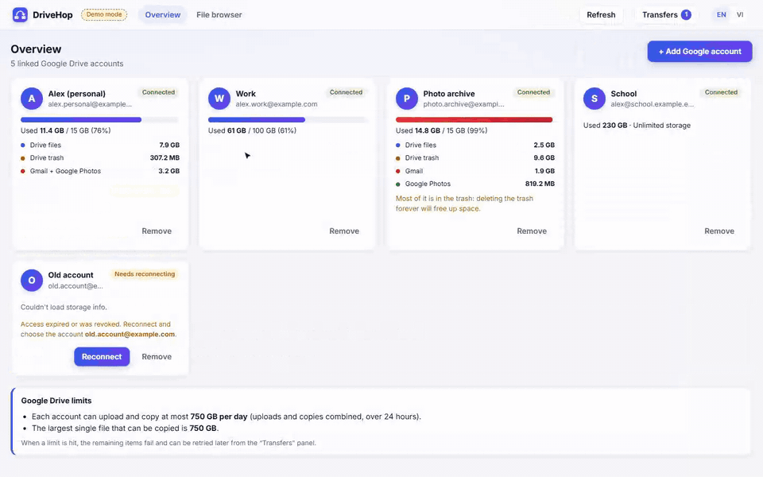
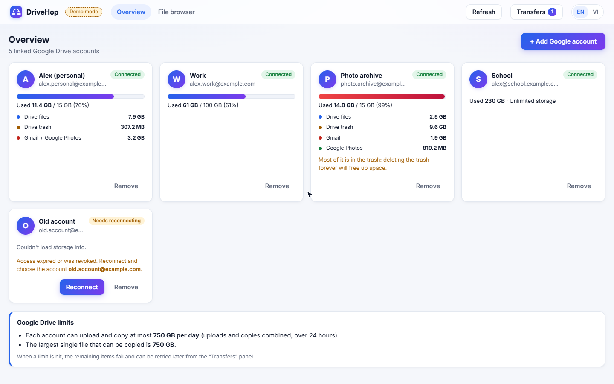
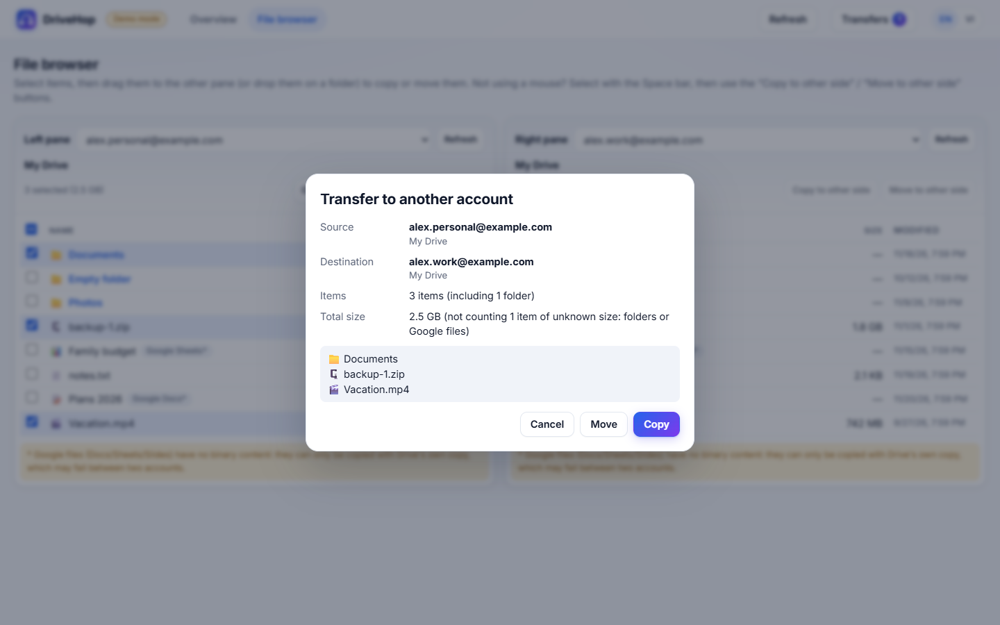
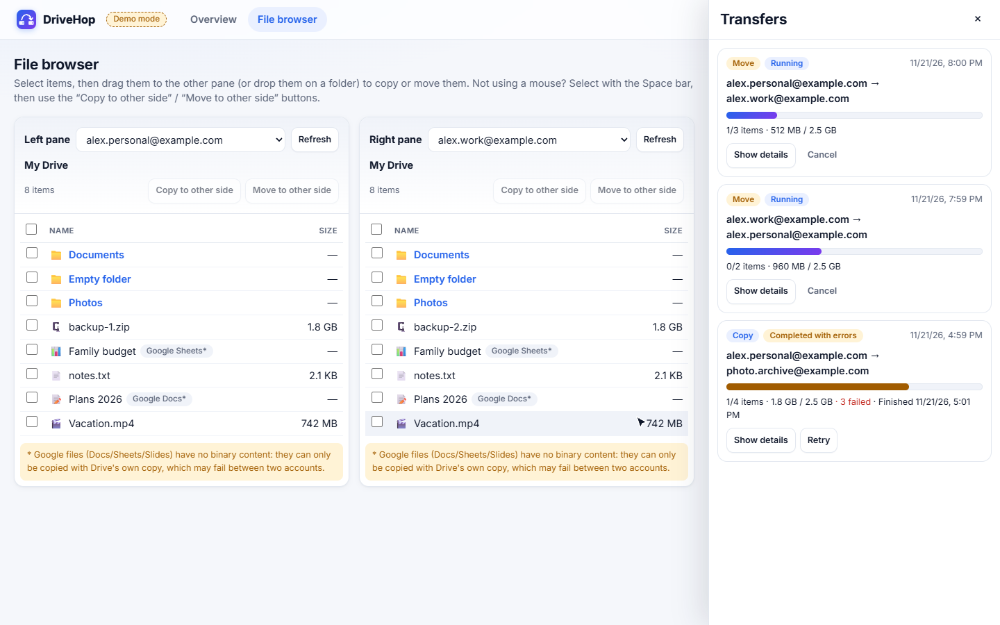

<div align="center">


# DriveHop

### Your Google Drive is full. Your other account isn't. Hop the files over.

Move or copy files between your own Google accounts, from your own PC.<br>
Google does the copying server-side, so even 100 GB never touches your disk.<br>
Free, open source, one double-click on Windows.

<p>
  <a href="https://github.com/phoenixvn/drivehop/releases/latest"></a>
  <a href="https://github.com/phoenixvn/drivehop/stargazers"></a>
  <a href="https://github.com/phoenixvn/drivehop/releases"></a>
  <a href="LICENSE"></a>
  
</p>

**[⬇ Download for Windows](https://github.com/phoenixvn/drivehop/releases/latest)** · [Quick start](#quick-start) · [FAQ](#faq) · [Report a bug](https://github.com/phoenixvn/drivehop/issues/new/choose) · [Discussions](https://github.com/phoenixvn/drivehop/discussions)

**English** · [Tiếng Việt](README.vi.md)

</div>



> The demo runs in demo mode (`?mock=1`, dev server only). None of the accounts or files in it are real. [Watch it as MP4](docs/media/demo.mp4).

## Real run

Free Google accounts fill up at 15 GB, and Google gives you no way to move files between your own accounts. DriveHop's first real run moved **~127 GB / ~69,000 files** from a full free account to a 5 TB one, unattended, with the laptop closed.

| Overview | Transfer confirmation | Live progress |
|---|---|---|
|  |  |  |

## What it does

### See every account on one page

Each account's storage is split into **Drive, Drive trash, Gmail and Google Photos**, with a hint about what is really filling it.

### Pick, drag, hop

A two-pane file browser: pick or drag items, then **Copy** or **Move** them to another account. DriveHop temporarily shares each file with the other account and Google makes the copy. No download or upload goes through your machine, except for a fallback path.

### Jobs you can trust

- **Move = copy, verify, then trash the original.** An optional, explicitly confirmed **Free up space** step empties the trash, because trashed files still count toward the 15 GB.
- Background jobs you can **resume, retry and verify**. Copies are idempotent, so a retry never creates duplicates.
- Handles Drive's quirks: shortcuts are recreated pointing at the copy of their target; Google Docs, Sheets and Slides are copied natively.
- Respects Google's limits: 750 GB per day, and backoff on rate limits.
- **English and Vietnamese UI**, switchable from the header.

### Stays yours

You bring **your own** Google OAuth client (free, ~10 minutes, guided in the app). Tokens are encrypted on your PC, with the key in Windows Credential Manager. There is no DriveHop server: no one else ever holds access to your Drive.

## Quick start

| You want to… | Use | You need |
|---|---|---|
| Just move my files | **Windows app** | Windows 10/11 x64 |
| Hack on it / run on macOS or Linux | **From source** | Node.js ≥ 22.12 |
| Jobs that run 24/7 with the browser closed | **Cloudflare Worker** | Workers Paid (5 USD/month) |

### Windows app (no Node needed)

1. Download `DriveHop-win-x64-v<version>.zip` from [Releases](https://github.com/phoenixvn/drivehop/releases/latest) and unzip it.
2. Double-click **`DriveHop.exe`**. The exe is not code-signed yet, so SmartScreen may warn: *More info → Run anyway*.
3. Your browser opens `http://localhost:8787`. The first-run screen walks you through creating your Google OAuth client; paste the Client ID and secret, and you're in.

Data lives in `%LOCALAPPDATA%\DriveHop\data`. Keep the console window open while you use the app; close it to quit. To build the exe yourself: `npm install && npm run build:desktop`.

### From source

```bash
git clone https://github.com/phoenixvn/drivehop.git
cd drivehop
npm install
cp .env.example .env    # then fill in GOOGLE_CLIENT_ID / GOOGLE_CLIENT_SECRET
npm run dev             # then open http://localhost:5173
```

Try the UI without Google at all: `http://localhost:5173/?mock=1`.

### Cloudflare Worker

```bash
cp apps/worker/wrangler.example.jsonc apps/worker/wrangler.jsonc   # git-ignored; set routes + Access vars
npm run build -w apps/web
cd apps/worker
npx wrangler deploy
npx wrangler secret put GOOGLE_CLIENT_ID
npx wrangler secret put GOOGLE_CLIENT_SECRET
npx wrangler secret put MULTICLOUD_MASTER_KEY   # base64 of 32 random bytes
```

The Worker refuses every request until the Cloudflare Access vars are set. Full walkthrough: [README.vi.md §7](README.vi.md#7-triển-khai-lên-cloudflare).

| | Local (`DriveHop.exe` or Node) | Cloudflare (Worker) |
|---|---|---|
| Cost | Free | Workers Paid (5 USD/month); Zero Trust free plan |
| Access | `127.0.0.1` only | Your domain, protected by Cloudflare Access |
| Jobs keep running when… | …the app is running | …always, even with the browser closed |
| Storage | SQLite file; tokens encrypted with a key in Windows Credential Manager | Durable Object SQLite; tokens encrypted with a Worker secret |

## Bring your own Google OAuth client

1. Create a project and enable the **Google Drive API**.
2. Set up the OAuth consent screen (External).
3. Create a **Web application** client with redirect URI `http://localhost:8787/api/auth/google/callback`, plus your domain's callback if you deploy to Cloudflare.
4. Publish the app ("In production", without verification) so refresh tokens don't expire after 7 days. You will see an "unverified app" warning when you sign in; that is expected, because it is your own app.

Step-by-step guide with the exact settings: [README.vi.md §5](README.vi.md#5-thiết-lập-google-cloud).

## FAQ

<details>
<summary>Is it free? Do I need to pay Google?</summary>

DriveHop is free and MIT-licensed. Creating your own Google OAuth client is free. You only pay for the destination storage you already have (for example a Google One plan), and the optional Cloudflare mode needs Workers Paid.

</details>

<details>
<summary>Do my files pass through my computer?</summary>

No. Google copies each file server-side between your accounts. DriveHop only sends API calls. A fallback path streams a file through the app only when Google refuses a server-side copy.

</details>

<details>
<summary>Why does Google say "this app isn't verified"?</summary>

Because the app is the OAuth client **you** created, and you did not submit it to Google for review (you don't need to for your own accounts). Click *Advanced → Go to … (unsafe)* to continue.

</details>

<details>
<summary>Can it move Google Photos?</summary>

Not yet. Since March 2025, Google's Photos API no longer lets third-party apps read your whole library. Use **Partner sharing** in Google Photos (share your library with your other account and turn on auto-save) or **Google Takeout**. A separate, unofficial local Photos helper is on the roadmap.

</details>

<details>
<summary>Is Move safe?</summary>

Move copies, verifies, then sends the original to the trash, so you can still restore it. Start with **Copy** on a small test folder anyway. **Free up space** deletes permanently and cannot be undone; it always asks first. See [README.vi.md §14](README.vi.md#14-bảo-mật-và-dữ-liệu) for where your data and tokens live.

</details>

<details>
<summary>macOS / Linux?</summary>

Run it from source today (Node.js ≥ 22.12). Prebuilt apps for other platforms are on the roadmap; [open a feature request](https://github.com/phoenixvn/drivehop/issues/new?template=feature_request.yml) if you need one.

</details>

## Sponsors ❤️

DriveHop is built and maintained by one person in their spare time. Sponsors keep it free for everyone.

<table>
<tr>
<td align="center" width="180">
<a href="https://github.com/phoenixvn/drivehop/issues/new?template=sponsorship.yml"></a>
</td>
<td>
<strong>Become the first sponsor.</strong> Cloud storage, backup and productivity tools whose users juggle several Google accounts are a natural fit. Your logo, a short description and a link go here.
<a href="https://github.com/phoenixvn/drivehop/issues/new?template=sponsorship.yml">Get in touch →</a>
</td>
</tr>
</table>

<!-- Donation links: uncomment once the accounts exist.
**Support the project:** [GitHub Sponsors](https://github.com/sponsors/phoenixvn) · [Ko-fi](https://ko-fi.com/YOUR_NAME)
-->

## Contributing

Bug fixes, translations, real-run reports and ideas are all welcome. If DriveHop saved you from paying for extra storage, **a ⭐ helps others find it.**

- **Questions & ideas:** [GitHub Discussions](https://github.com/phoenixvn/drivehop/discussions)
- **Bugs:** use the [issue templates](https://github.com/phoenixvn/drivehop/issues/new/choose) with your Windows version, DriveHop version, steps to reproduce and logs (with emails and file names removed)
- **Code:** see [CONTRIBUTING.md](CONTRIBUTING.md)

Maintained by one person; replies may take a while, and there is no one-on-one setup support.

## Star History

<a href="https://star-history.com/#phoenixvn/drivehop&Date">
  
</a>

## Stack & license

TypeScript monorepo: React 19 + Vite front end; a shared `core` transfer engine calling Google Drive API v3 with `fetch`; Fastify + better-sqlite3 locally, or Cloudflare Workers + a SQLite Durable Object; tokens encrypted with AES-256-GCM; about 350 automated tests.

Thanks to Fastify, React, Vite, better-sqlite3, napi-rs/keyring, Node.js, and every contributor. [MIT License](LICENSE).
