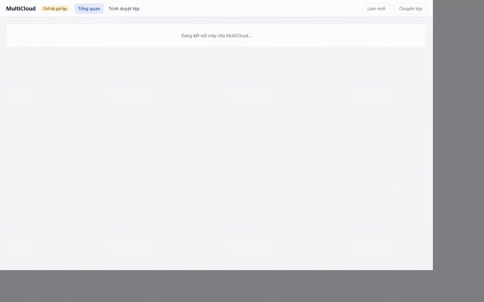
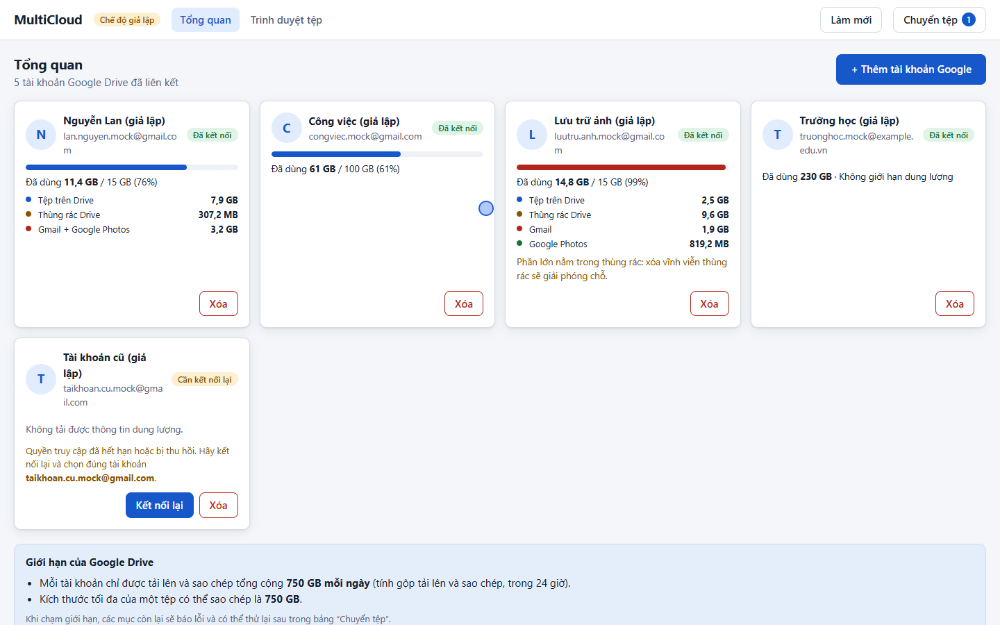
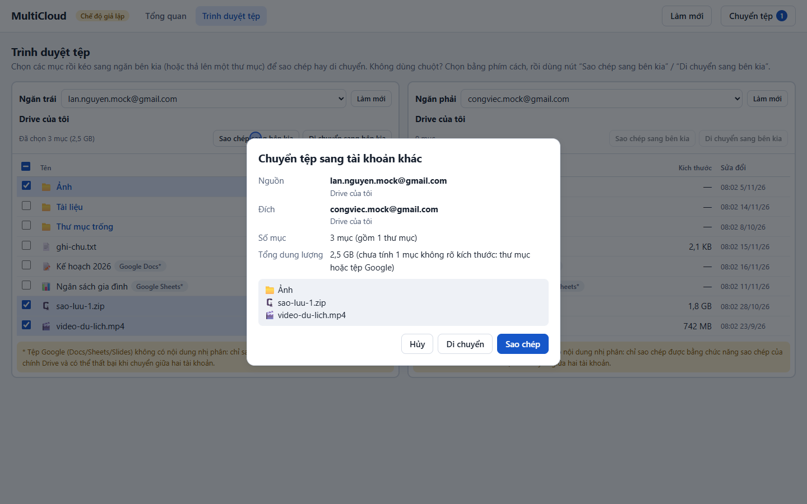
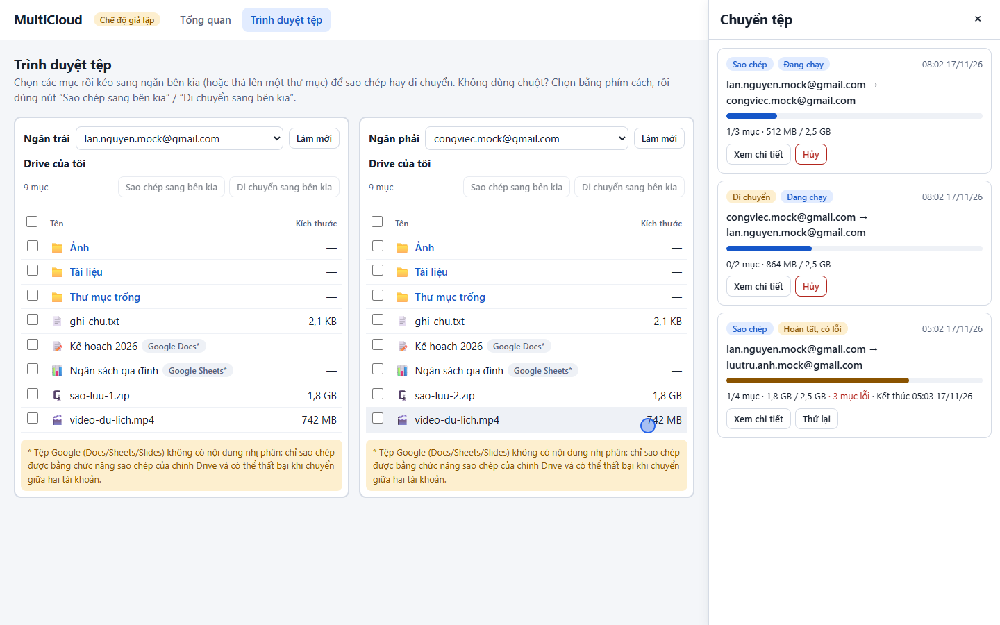

# DriveHop

**English** · [Tiếng Việt (full guide)](README.vi.md)

A self-hosted dashboard for people with several Google accounts. See every account's storage in one place, then copy or move files between accounts. The copies run on Google's servers, so nothing passes through your machine.



> The demo runs in mock mode (`?mock=1`). None of the accounts or files in it are real.

## Why

Free Google accounts fill up at 15 GB, and Google gives you no way to move files between your own accounts. DriveHop's first real run moved **~127 GB / ~69,000 files** from a full free account to a 5 TB one, unattended, with the laptop closed.

## Features

- **Every account on one page.** Each account's storage is split into **Drive, Drive trash, Gmail and Google Photos**, with a hint about what is really filling it.
- **Two-pane file browser.** Pick or drag items, then **Copy** or **Move** them to another account.
- **Server-side copies.** DriveHop temporarily shares the file with the other account and Google makes the copy. No download or upload goes through your machine, except for a fallback path.
- **Background jobs you can resume, retry and verify.** On Cloudflare they keep running after you close the browser.
- **Move = copy, verify, then trash the original.** An optional, explicitly confirmed **Free up space** step empties the trash, because trashed files still count toward the 15 GB.
- **Handles Drive's quirks:**
  - Shortcuts are recreated at the destination, pointing at the copy of their target.
  - Google Docs, Sheets and Slides are copied natively.
  - Copies are idempotent, so a retry never creates duplicates.
- **Respects Google's limits:** 750 GB per day, and backoff on rate limits.

| Overview | Transfer confirmation | Live progress |
|---|---|---|
|  |  |  |

## Two ways to run it

| | Local (Node) | Cloudflare (Worker) |
|---|---|---|
| Cost | Free | Workers Paid (5 USD/month); Zero Trust free plan |
| Access | `127.0.0.1` only | Your domain, protected by Cloudflare Access |
| Jobs keep running when… | …the app is running | …always, even with the browser closed |
| Storage | SQLite file; tokens encrypted with a key in Windows Credential Manager | Durable Object SQLite; tokens encrypted with a Worker secret |

## Bring your own Google OAuth client

You create **your own** OAuth client in Google Cloud. It takes about 10 minutes and is free. No one else ever holds your tokens, and the app does not need Google's verification:

1. Create a project and enable the **Google Drive API**.
2. Set up the OAuth consent screen (External) and add your Google accounts as test users.
3. Create a **Web application** client with redirect URI `http://localhost:8787/api/auth/google/callback`, plus your domain's callback if you deploy to Cloudflare.
4. Publish the app ("In production", without verification) so refresh tokens don't expire after 7 days. You will see an "unverified app" warning when you sign in, and that is expected.

Step-by-step with screenshots of the right settings: [README.vi.md §5](README.vi.md#5-thiết-lập-google-cloud).

## Quick start (local)

Requires Node.js ≥ 22.12 and npm.

```bash
git clone https://github.com/phoenixvn/drivehop.git
cd drivehop
npm install
cp .env.example .env    # then fill in GOOGLE_CLIENT_ID / GOOGLE_CLIENT_SECRET
npm run dev             # then open http://localhost:5173
```

Try the UI without Google at all: `http://localhost:5173/?mock=1`.

## Deploy to Cloudflare

```bash
cp apps/worker/wrangler.example.jsonc apps/worker/wrangler.jsonc   # git-ignored; set routes + Access vars
npm run build -w apps/web
cd apps/worker
npx wrangler deploy
npx wrangler secret put GOOGLE_CLIENT_ID
npx wrangler secret put GOOGLE_CLIENT_SECRET
npx wrangler secret put MULTICLOUD_MASTER_KEY   # base64 of 32 random bytes
```

The Worker refuses every request until the Cloudflare Access vars are set. The full walkthrough is in [README.vi.md §7](README.vi.md#7-triển-khai-lên-cloudflare).

## Google Photos?

Since March 2025, Google's Photos API no longer lets third-party apps read your whole library, so DriveHop cannot move Photos. Your options:

- **Partner sharing** (built into Google Photos): share your library with your other account and turn on auto-save.
- **Google Takeout**, then re-upload.
- A local Photos helper is on the roadmap. It will be separate and unofficial, and it will run on your machine only.

## Stack

TypeScript monorepo:

- React 19 + Vite front end.
- A shared `core` transfer engine that calls Google Drive API v3 directly with `fetch`.
- Fastify + better-sqlite3 locally, or Cloudflare Workers + a SQLite Durable Object, where work advances in alarm-driven slices.
- Tokens encrypted with AES-256-GCM.
- About 340 automated tests.

## Status & safety

This is a personal tool, shared as-is. Start with **Copy** on a small test folder before you use **Move**. **Free up space** deletes permanently and cannot be undone. Read [README.vi.md §14](README.vi.md#14-bảo-mật-và-dữ-liệu) for where your data and tokens live.

## Support

If DriveHop saved you from paying for storage, a ⭐ helps others find it.
Want to buy me a coffee? <!-- TODO: replace with real links -->
[GitHub Sponsors](https://github.com/sponsors/phoenixvn) · [Ko-fi](https://ko-fi.com/your-ko-fi-name)

## License

[MIT](LICENSE)
