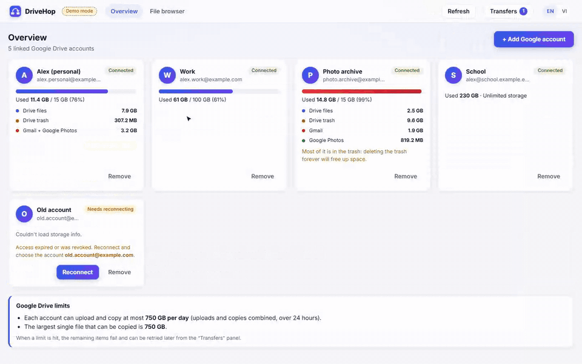

<div align="center">


# DriveHop

### Drive đầy rồi, tài khoản kia còn trống? Chuyển qua trong một nốt nhạc.

<p>
  <a href="https://github.com/phoenixvn/drivehop/releases/latest"></a>
  <a href="https://github.com/phoenixvn/drivehop/stargazers"></a>
  <a href="https://github.com/phoenixvn/drivehop/releases"></a>
  <a href="LICENSE"></a>
</p>

**[⬇ Tải bản Windows](https://github.com/phoenixvn/drivehop/releases/latest)** · [Báo lỗi](https://github.com/phoenixvn/drivehop/issues/new/choose) · [Hỏi đáp](https://github.com/phoenixvn/drivehop/discussions)

[English](README.md) · **Tiếng Việt**

</div>



> Ảnh động quay ở chế độ demo (`?mock=1`), giao diện tiếng Anh; bấm **VI** ở góc phải để dùng tiếng Việt. Không có tài khoản hay tệp thật nào.

Bảng điều khiển để quản lý nhiều tài khoản Google Drive cùng lúc và sao chép hoặc di chuyển tệp, thư mục giữa các tài khoản bằng cách kéo thả.

Có hai cách chạy cùng một ứng dụng:

- **Trên máy của bạn.** Cách nhanh nhất là **bản Windows dựng sẵn** (`DriveHop.exe`, không cần cài Node, xem [mục 4](#4-chạy-cục-bộ-bằng-node)); hoặc chạy máy chủ Node từ mã nguồn. Chỉ nghe ở `127.0.0.1`, dữ liệu nằm trong một tệp SQLite trên máy.
- **Trên Cloudflare (Worker).** Truy cập qua một tên miền riêng, được Cloudflare Access bảo vệ, việc chuyển tệp chạy nền ngay cả khi bạn đã đóng trình duyệt.

Hai cách dùng chung giao diện web và chung bộ máy chuyển tệp (`packages/core`). Dữ liệu của chúng tách biệt: tài khoản đã liên kết trên máy không tự xuất hiện trên Cloudflare và ngược lại.

## Mục lục

1. [Giới thiệu](#1-giới-thiệu)
2. [Tổng quan kiến trúc](#2-tổng-quan-kiến-trúc)
3. [Yêu cầu](#3-yêu-cầu)
4. [Chạy cục bộ bằng Node](#4-chạy-cục-bộ-bằng-node)
5. [Thiết lập Google Cloud](#5-thiết-lập-google-cloud)
6. [Chạy thử Worker cục bộ](#6-chạy-thử-worker-cục-bộ)
7. [Triển khai lên Cloudflare](#7-triển-khai-lên-cloudflare)
8. [Thêm tài khoản](#8-thêm-tài-khoản)
9. [Cách dùng](#9-cách-dùng)
10. [Cách sao chép giữa các tài khoản hoạt động](#10-cách-sao-chép-giữa-các-tài-khoản-hoạt-động)
11. [Cách hoạt động nền trên Cloudflare](#11-cách-hoạt-động-nền-trên-cloudflare)
12. [Giới hạn của Google](#12-giới-hạn-của-google)
13. [Chi phí và giới hạn của Cloudflare](#13-chi-phí-và-giới-hạn-của-cloudflare)
14. [Bảo mật và dữ liệu](#14-bảo-mật-và-dữ-liệu)
15. [Khắc phục sự cố](#15-khắc-phục-sự-cố)
16. [Cấu trúc dự án](#16-cấu-trúc-dự-án)
17. [Đã chạy thật tới đâu](#17-đã-chạy-thật-tới-đâu)
18. [Đã kiểm tra với tài liệu](#18-đã-kiểm-tra-với-tài-liệu)

---

## 1. Giới thiệu

DriveHop làm được những việc sau:

- Liên kết nhiều tài khoản Google Drive (ví dụ 5 tài khoản) và hiển thị tất cả trên một trang "Tổng quan": tên, email, trạng thái kết nối, dung lượng đã dùng.
- Duyệt tệp của hai tài khoản cạnh nhau trong "Trình duyệt tệp" (hai ngăn).
- Sao chép hoặc di chuyển tệp và thư mục từ ngăn này sang ngăn kia bằng kéo thả hoặc bằng nút bấm.
- Theo dõi tiến độ, hủy tác vụ và thử lại các mục lỗi trong bảng "Chuyển tệp".

Phạm vi của ứng dụng:

- Dành cho **một người dùng**. Ứng dụng không có màn hình đăng nhập riêng.
  - Trên máy (Node): ai dùng được phiên Windows của bạn thì dùng được DriveHop.
  - Trên Cloudflare: chỉ người qua được Cloudflare Access (bạn cấu hình cho đúng một email) mới mở được trang.
- Hiện chỉ hỗ trợ Google Drive. Google nằm sau giao diện `CloudProvider` để sau này thêm được dịch vụ khác (xem [mục 16](#16-cấu-trúc-dự-án)).

Những việc ứng dụng chưa làm:

- Chưa hỗ trợ dịch vụ lưu trữ nào khác ngoài Google Drive.
- Trình duyệt tệp bắt đầu từ "Drive của tôi". Mục "Được chia sẻ với tôi" và bộ nhớ dùng chung (shared drive) không có lối vào riêng.
- Không tải tệp lên từ máy, không tải tệp về máy, không đổi tên, không tạo thư mục thủ công và không xóa tệp.
- Trên máy, có hai cách chạy: bản Windows dựng sẵn `DriveHop.exe` (tự phục vụ giao diện ở `http://localhost:8787`), hoặc `npm run dev` từ mã nguồn (giao diện chạy bằng Vite). Bản chạy trên mạng là Worker của Cloudflare.

## 2. Tổng quan kiến trúc

```
                    packages/shared  (hợp đồng API, kiểu dữ liệu)
                    packages/core    (OAuth Google, Drive qua fetch, mã hóa token,
                                      bộ máy chuyển tệp, kiểm tra dữ liệu vào)
                          │                                  │
          ┌───────────────┴──────────────┐   ┌───────────────┴────────────────────────┐
          │ MÁY CHỦ CỤC BỘ (apps/server) │   │ CLOUDFLARE (apps/worker)               │
          │ Node + Fastify               │   │ 1 Worker: giao diện tĩnh + /api/*      │
          │ SQLite: better-sqlite3       │   │   kiểm tra JWT của Cloudflare Access   │
          │ Khóa chính: kho khóa của     │   │   cho MỌI yêu cầu                      │
          │   Windows, hoặc biến         │   │ 1 Durable Object "core" (SQLite):      │
          │   MULTICLOUD_MASTER_KEY      │   │   tài khoản, tác vụ, bộ máy chuyển tệp │
          │ Nghe ở 127.0.0.1             │   │   chạy nền bằng alarm                  │
          │ Giao diện: Vite dev server   │   │ Khóa chính: secret MULTICLOUD_MASTER_KEY│
          └──────────────────────────────┘   └────────────────────────────────────────┘
                          │                                  │
                          └──────── apps/web (React) ────────┘
```

- **`packages/core`** chứa mọi thứ không phụ thuộc nơi chạy: luồng OAuth và Google Drive viết bằng `fetch`, mã hóa AES-256-GCM bằng WebCrypto, bộ máy chuyển tệp và cơ chế thử lại.
- **Máy chủ Node (`apps/server`)** là bản chạy cục bộ. Nó dùng Fastify, lưu dữ liệu bằng `better-sqlite3` trong `data/multicloud.sqlite`, lấy khóa chính từ Windows Credential Manager (hoặc từ biến môi trường `MULTICLOUD_MASTER_KEY` nếu kho khóa không dùng được).
- **Worker (`apps/worker`)** là bản chạy trên Cloudflare: một Worker phục vụ giao diện đã build và chuyển `/api/*` vào **một** Durable Object tên `core`, dùng bộ nhớ SQLite của Durable Object. Việc chuyển tệp chạy trong các lượt alarm (xem [mục 11](#11-cách-hoạt-động-nền-trên-cloudflare)).
- **Giao diện (`apps/web`)** giống nhau ở cả hai nơi và luôn gọi API bằng đường dẫn tương đối `/api`.

## 3. Yêu cầu

- Windows 11 (để chạy cục bộ và để chạy lệnh triển khai).
- Node.js 22, phiên bản 22.12.0 trở lên (`package.json` khai báo `"node": ">=22.12.0"`).
- npm (đi kèm Node.js). Dự án dùng npm workspaces. Không dùng pnpm.
- Một tài khoản Google để tạo dự án trên Google Cloud Console (miễn phí).
- Chỉ khi triển khai lên Cloudflare: một tài khoản Cloudflare có gói **Workers Paid**, một tên miền đã ở trạng thái active trên Cloudflare, và Cloudflare Zero Trust (gói Free là đủ cho một người dùng). Xem [mục 7](#7-triển-khai-lên-cloudflare).

Kiểm tra phiên bản:

```powershell
node --version
npm --version
```

## 4. Chạy cục bộ bằng Node

### Cách nhanh nhất: bản Windows dựng sẵn

1. Tải `DriveHop-win-x64-v<phiên bản>.zip` ở trang **Releases** của repo, giải nén.
2. Nhấp đúp `DriveHop.exe`. Windows SmartScreen có thể cảnh báo vì tệp chưa được ký số: bấm **More info** > **Run anyway**.
3. Một cửa sổ dòng lệnh mở ra và trình duyệt tự mở `http://localhost:8787`. Giữ cửa sổ đó mở trong lúc dùng; đóng nó để tắt DriveHop.
4. Lần đầu, trang **Thiết lập lần đầu** hướng dẫn tạo OAuth client Google của riêng bạn (giống [mục 5](#5-thiết-lập-google-cloud), redirect URI là `http://localhost:8787/api/auth/google/callback`). Dán Client ID và secret vào form, DriveHop tự khởi động lại và sẵn sàng thêm tài khoản.

Bản dựng sẵn không cần cài Node. Dữ liệu (tài khoản, tác vụ, OAuth client) nằm ở `%LOCALAPPDATA%\DriveHop\data`; khóa mã hóa token nằm trong Windows Credential Manager. Form thiết lập chỉ hiện khi chưa có tài khoản nào: refresh token gắn với OAuth client đã cấp nó, nên đổi client sau khi đã liên kết tài khoản sẽ làm hỏng các tài khoản đó. Muốn đổi client, gỡ hết tài khoản rồi xóa tệp `config.env` trong thư mục dữ liệu.

Tự dựng bản này từ mã nguồn (Windows x64): `npm install` rồi `npm run build:desktop`. Kết quả nằm trong thư mục `release/`.

### Chạy từ mã nguồn

Chạy mọi lệnh ở thư mục gốc của dự án (`DriveHop`).

### Bước 1: cài thư viện

```powershell
npm install
```

### Bước 2: tạo tệp `.env`

```powershell
Copy-Item .env.example .env
```

Nếu dùng Command Prompt (cmd) thì gõ `copy .env.example .env`.

Tệp `.env` phải nằm ở thư mục gốc của dự án. Các biến:

| Biến | Mặc định | Ý nghĩa |
| --- | --- | --- |
| `GOOGLE_CLIENT_ID` | (trống) | Client ID của OAuth client, lấy ở [mục 5](#5-thiết-lập-google-cloud). Bắt buộc. |
| `GOOGLE_CLIENT_SECRET` | (trống) | Client secret của OAuth client. Bắt buộc. |
| `PORT` | `8787` | Cổng của máy chủ API. Redirect URI của Google phụ thuộc vào cổng này. |
| `WEB_ORIGIN` | `http://localhost:5173` | Địa chỉ gốc của giao diện web. Quyết định cổng mà giao diện chạy; máy chủ cũng dùng nó cho CORS và để chuyển hướng về giao diện sau khi đăng nhập Google. |
| `MULTICLOUD_MASTER_KEY` | (trống) | Khóa dự phòng, chỉ dùng khi Windows Credential Manager không dùng được. Xem [mục 14](#14-bảo-mật-và-dữ-liệu). |
| `DATA_DIR` | `./data` | Thư mục chứa cơ sở dữ liệu SQLite, tính từ thư mục gốc của dự án. |

Biến môi trường đặt sẵn trong cửa sổ dòng lệnh được ưu tiên hơn giá trị trong `.env`. Máy chủ không tự đọc lại `.env`: sau khi sửa tệp này, hãy dừng (Ctrl+C) rồi chạy lại.

Bạn có thể chạy ứng dụng khi chưa điền `GOOGLE_CLIENT_ID` và `GOOGLE_CLIENT_SECRET`. Khi đó giao diện hiện thông báo "DriveHop chưa được thiết lập xong." và chưa thêm được tài khoản.

### Bước 3: chạy

```powershell
npm run dev
```

Lệnh này chạy đồng thời hai tiến trình:

| Thành phần | Địa chỉ mặc định |
| --- | --- |
| Giao diện web (Vite) | `http://localhost:5173` |
| Máy chủ API (Fastify) | `http://127.0.0.1:8787` (giao diện gọi qua đường dẫn `/api` của cổng giao diện) |

Mở trình duyệt ở **`http://localhost:5173`** (hoặc cổng bạn đặt trong `WEB_ORIGIN`). Không dùng `http://127.0.0.1:5173`: cookie của bước đăng nhập Google và địa chỉ Google chuyển hướng về đều dùng tên `localhost`, nên nếu mở bằng `127.0.0.1` thì việc thêm tài khoản sẽ thất bại.

Dừng ứng dụng bằng Ctrl+C trong cửa sổ đang chạy `npm run dev`.

Muốn xem thử giao diện với dữ liệu giả lập (không cần Google, không gọi máy chủ), mở `http://localhost:5173/?mock=1`. Giao diện sẽ hiện nhãn "Chế độ giả lập".

### Nếu cổng 5173 đã có ứng dụng khác dùng

Trên nhiều máy, cổng 5173 đã bị một ứng dụng Vite khác chiếm. Giao diện không tự chọn cổng khác: nếu cổng đang bận, Vite dừng với lỗi `Port 5173 is already in use` và `npm run dev` dừng luôn cả máy chủ.

Cổng của giao diện lấy từ `WEB_ORIGIN` trong `.env`, nên chỉ cần sửa một dòng rồi chạy lại `npm run dev`, ví dụ:

```
WEB_ORIGIN=http://localhost:5183
```

Sau đó mở `http://localhost:5183`. `WEB_ORIGIN` phải có dạng `http://localhost:<cổng>`. Redirect URI trên Google không cần đổi, vì nó phụ thuộc vào `PORT` của máy chủ chứ không phụ thuộc cổng của giao diện.

Muốn biết ứng dụng nào đang chiếm cổng:

```powershell
Get-NetTCPConnection -LocalPort 5173 | Select-Object OwningProcess
Get-Process -Id <số OwningProcess ở trên>
```

### Nếu muốn đổi cổng máy chủ (`PORT`)

Đổi `PORT` kéo theo hai việc:

1. Sửa `PORT` trong `.env`, ví dụ `PORT=8791`. Giao diện tự chuyển tiếp `/api` tới cổng mới.
2. Thêm redirect URI tương ứng trên Google Cloud, ví dụ `http://localhost:8791/api/auth/google/callback` (xem [mục 5](#5-thiết-lập-google-cloud)).

Ví dụ một cấu hình hay dùng khi 5173 và 8787 đều bận: `PORT=8791` và `WEB_ORIGIN=http://localhost:5183`.

### Kiểm tra kiểu, chạy test, build

```powershell
npm run typecheck
npm run test
npm run build
```

- `npm run typecheck`: kiểm tra kiểu TypeScript cho cả năm gói (`shared`, `core`, `server`, `web`, `worker`).
- `npm run test`: chạy bộ test tự động (Vitest) của `core`, `server`, `web` và `worker`. Test của `worker` chạy trong môi trường `workerd` giống Cloudflare. Google Drive luôn được **giả lập** trong test.
- `npm run build`: với máy chủ, lệnh này chỉ kiểm tra kiểu; với giao diện, nó tạo bản build tĩnh trong `apps/web/dist`. Máy chủ Node không phục vụ bản build đó (trên máy bạn vẫn chạy `npm run dev`); Worker thì phục vụ chính thư mục này.

## 5. Thiết lập Google Cloud

DriveHop đăng nhập Google bằng OAuth client của riêng bạn. Bạn cần tạo client này một lần. **Một OAuth client dùng chung cho cả máy chủ Node và Worker**: bạn chỉ cần thêm nhiều redirect URI vào cùng client đó ([bước 6](#bước-6-tạo-oauth-client-loại-web-application)).

Tên các mục dưới đây theo tài liệu hiện tại của Google (giao diện "Google Auth Platform"). Nhãn trên Console có thể khác đôi chút, hoặc được dịch nếu bạn đặt Console sang tiếng Việt.

Vài điều cần biết trước:

- DriveHop xin scope `https://www.googleapis.com/auth/drive` (toàn quyền với Drive) cùng `openid`, `email`, `profile`. Scope `drive` thuộc nhóm **restricted** (bị hạn chế).
- Một ứng dụng công khai dùng scope restricted phải qua xác minh scope restricted và đánh giá bảo mật. Yêu cầu đó không áp dụng cho ứng dụng cá nhân chỉ do chính chủ sở hữu sử dụng, như DriveHop.

### Bước 1: tạo project

1. Mở <https://console.cloud.google.com/> và đăng nhập bằng một tài khoản Google của bạn.
2. Bấm bộ chọn project ở thanh trên cùng, chọn **New project**, đặt tên (ví dụ `DriveHop`), bấm **Create**.
3. Chọn project vừa tạo. Mọi bước sau đều làm trong project này.

### Bước 2: bật Google Drive API

1. Vào Menu > **APIs & Services** > **Library**.
2. Tìm **Google Drive API** và mở nó.
3. Bấm **Enable**.

### Bước 3: cấu hình màn hình đồng ý (Google Auth Platform)

1. Vào Menu > **Google Auth platform** > **Branding**.
2. Nếu thấy thông báo "Google Auth platform not configured yet", bấm **Get started**.
3. **App Information**: nhập **App name** (ví dụ `DriveHop`) và chọn **User support email** (email của bạn). Bấm **Next**.
4. **Audience**: chọn **External**. Bấm **Next**.
5. **Contact Information**: nhập email của bạn. Bấm **Next**.
6. **Finish**: đọc và đồng ý với Google API Services User Data Policy, bấm **Continue**, rồi bấm **Create**.

### Bước 4: khai báo scope

1. Vào **Google Auth platform** > **Data Access**.
2. Bấm **Add or remove scopes**.
3. Thêm các scope sau (nếu không thấy trong danh sách thì dán vào ô nhập scope thủ công):

   ```
   https://www.googleapis.com/auth/drive
   openid
   https://www.googleapis.com/auth/userinfo.email
   https://www.googleapis.com/auth/userinfo.profile
   ```

4. Bấm **Save**.

### Bước 5: thêm cả 5 tài khoản làm test user

1. Vào **Google Auth platform** > **Audience**.
2. Ở phần **Test users**, bấm **Add users**.
3. Nhập địa chỉ email của **tất cả** các tài khoản Google bạn định liên kết (cả 5 tài khoản, kể cả tài khoản đang dùng để tạo project). Bấm **Save**.

Khi ứng dụng ở trạng thái Testing, chỉ các test user trong danh sách này mới đăng nhập được. Danh sách tối đa 100 test user.

Danh sách này không liên quan tới email đăng nhập Cloudflare Access ở [mục 7](#7-triển-khai-lên-cloudflare): Access quyết định ai mở được trang DriveHop, còn test user quyết định tài khoản Google nào liên kết được.

### Bước 6: tạo OAuth client loại "Web application"

1. Vào **Google Auth platform** > **Clients**.
2. Bấm **Create client**.
3. **Application type**: chọn **Web application**.
4. **Name**: đặt tên tùy ý (chỉ hiển thị trong Console).
5. **Authorized JavaScript origins**: để trống.
6. **Authorized redirect URIs**: thêm các địa chỉ dưới đây. Một client chứa được nhiều redirect URI; hãy thêm cả những địa chỉ bạn sẽ dùng.

   | Dùng cho | Redirect URI |
   | --- | --- |
   | Máy chủ Node trên máy (cổng mặc định) | `http://localhost:8787/api/auth/google/callback` |
   | Worker chạy thử bằng `wrangler dev` ([mục 6](#6-chạy-thử-worker-cục-bộ)) | `http://127.0.0.1:8799/api/auth/google/callback` |
   | Worker trên Cloudflare ([mục 7](#7-triển-khai-lên-cloudflare)) | `https://cloud.ten-mien-cua-ban.com/api/auth/google/callback` |

   - Máy chủ Node tạo địa chỉ `http://localhost:<PORT>/api/auth/google/callback`: `http` (không phải `https`), `localhost` (không phải `127.0.0.1`), cổng bằng giá trị `PORT` trong `.env`. Nếu bạn đổi `PORT` (ví dụ `8791`), thêm địa chỉ với cổng đó.
   - Worker tạo địa chỉ từ chính địa chỉ đang mở trang: `<địa chỉ gốc>/api/auth/google/callback`. Thay `cloud.ten-mien-cua-ban.com` bằng **tên miền thật** bạn gắn cho Worker (cùng giá trị với `routes` trong `wrangler.jsonc`).
   - Không có dấu `/` ở cuối. Mọi ký tự phải khớp.
   - Google yêu cầu `https` cho redirect URI, trừ địa chỉ localhost (kể cả địa chỉ IP localhost), nên hai địa chỉ `http` ở trên được chấp nhận.

7. Bấm **Create**.
8. Sao chép ngay **Client ID** và **Client secret**. Google chỉ hiện đầy đủ client secret một lần lúc tạo. Nếu lỡ mất, mở client đó và dùng **Add secret** để tạo secret mới.

Nếu client đã tạo từ trước (ví dụ khi mới dùng bản Node), chỉ cần mở client đó trong **Clients** và thêm redirect URI mới rồi bấm **Save**. Không cần tạo client thứ hai.

Thay đổi trên Console có thể cần từ 5 phút đến vài giờ mới có hiệu lực.

### Bước 7: điền Client ID và secret

- Máy chủ Node: điền vào `.env`

  ```
  GOOGLE_CLIENT_ID=<Client ID vừa sao chép>
  GOOGLE_CLIENT_SECRET=<Client secret vừa sao chép>
  ```

  Lưu tệp, dừng `npm run dev` (Ctrl+C) và chạy lại. Trong giao diện, bấm "Kiểm tra lại" nếu thông báo thiết lập vẫn còn.

- Worker chạy thử: điền vào `apps/worker/.dev.vars` ([mục 6](#6-chạy-thử-worker-cục-bộ)).
- Worker trên Cloudflare: đặt bằng `wrangler secret put` ([mục 7](#7-triển-khai-lên-cloudflare)). Không ghi vào tệp nào trong dự án.

### Bước 8: chọn Testing hay In production

Ứng dụng mới tạo có **Publishing status** là **Testing**.

- Ở trạng thái Testing với user type External, refresh token hết hạn sau 7 ngày (trừ khi ứng dụng chỉ xin các scope tên, email, hồ sơ; DriveHop xin thêm scope Drive nên bị áp dụng). Nghĩa là **mỗi tuần bạn phải kết nối lại từng tài khoản**, ở mỗi nơi bạn dùng (Node và Worker giữ token riêng).
- Để tránh việc đó, chuyển ứng dụng sang **In production**: vào **Google Auth platform** > **Audience** và bấm **Publish app**. Bạn không cần gửi yêu cầu xác minh. Sau khi publish, refresh token không còn hết hạn sau 7 ngày. Đổi lại, mỗi lần đăng nhập bạn sẽ thấy cảnh báo ứng dụng chưa được xác minh và phải bấm tiếp tục qua cảnh báo đó (xem [mục 8](#8-thêm-tài-khoản)).
- Sau khi publish, hãy kết nối lại mỗi tài khoản một lần. Token được cấp lúc còn Testing vẫn có thể hết hạn theo mốc 7 ngày cũ.
- Ứng dụng chưa xác minh bị giới hạn 100 người dùng mới. Với 5 tài khoản của bạn thì không ảnh hưởng.

Ngoài mốc 7 ngày, refresh token còn ngừng hoạt động khi bạn thu hồi quyền của ứng dụng hoặc khi token không được dùng trong sáu tháng. Google cũng giới hạn 100 refresh token cho mỗi tài khoản Google trên mỗi OAuth client; vượt quá thì token cũ nhất bị vô hiệu mà không báo trước. Kết nối cùng một tài khoản ở cả Node và Worker là 2 token, không đáng lo.

### Không commit, không chia sẻ `.env` và `.dev.vars`

Tệp `.env` và `apps/worker/.dev.vars` chứa client secret. Không commit, không gửi cho người khác, không dán vào chỗ công khai. `.gitignore` của dự án đã loại trừ `.env`, `.env.*` (trừ `.env.example`), `.dev.vars`, `.dev.vars.*` (trừ `.dev.vars.example`), `.wrangler/` và thư mục `data/`.

## 6. Chạy thử Worker cục bộ

Bước này chạy đúng mã của Worker trên máy bạn bằng `wrangler dev`, trước khi triển khai thật. Không cần tài khoản Cloudflare cho bước này. Không dùng nó cho dữ liệu thật lâu dài: trạng thái nằm trong `apps/worker/.wrangler/` trên máy.

### Bước 1: build giao diện

Worker phục vụ giao diện từ `apps/web/dist` (khai báo `assets.directory` là `../web/dist` trong `apps/worker/wrangler.jsonc`), nên phải build trước:

```powershell
npm run build -w @multicloud/web
```

Build lại mỗi khi giao diện thay đổi.

### Bước 2: tạo `apps/worker/.dev.vars`

```powershell
Copy-Item apps/worker/.dev.vars.example apps/worker/.dev.vars
```

Mở `apps/worker/.dev.vars` và điền:

| Biến | Giá trị |
| --- | --- |
| `GOOGLE_CLIENT_ID` | Client ID ở [mục 5](#5-thiết-lập-google-cloud). |
| `GOOGLE_CLIENT_SECRET` | Client secret. |
| `MULTICLOUD_MASTER_KEY` | Một khóa **dùng riêng để thử**, tạo bằng lệnh bên dưới. Không dùng lại khóa của bản triển khai thật. |
| `ACCESS_TEAM_DOMAIN` | **Để trống.** Không có Cloudflare Access trước `wrangler dev`. |
| `ACCESS_AUD` | **Để trống.** |
| `DEV_AUTH_BYPASS` | `true` |

Tạo khóa 32 byte ngẫu nhiên dạng base64:

```powershell
node -e "console.log(require('node:crypto').randomBytes(32).toString('base64'))"
```

Trên Google Cloud, client phải có redirect URI `http://127.0.0.1:8799/api/auth/google/callback` ([mục 5, bước 6](#bước-6-tạo-oauth-client-loại-web-application)).

### Bước 3: chạy

```powershell
npm run dev -w @multicloud/worker
```

Script này chạy `wrangler dev --ip 127.0.0.1 --port 8799`. Mở **`http://127.0.0.1:8799`**. Dừng bằng Ctrl+C.

### Về `DEV_AUTH_BYPASS`

Chép `.dev.vars.example` thành `.dev.vars` là đã bật sẵn `DEV_AUTH_BYPASS=true`.

Worker kiểm tra JWT của Cloudflare Access cho **mọi** yêu cầu, kể cả trang giao diện. Khi chạy thử không có Access, `DEV_AUTH_BYPASS=true` cho phép bỏ qua bước này, nhưng chỉ khi **đồng thời**:

- giá trị đúng bằng `true`;
- `ACCESS_TEAM_DOMAIN` và `ACCESS_AUD` đều trống;
- tên máy trong URL của yêu cầu đúng là `127.0.0.1` hoặc `localhost`.

> **Cảnh báo.** `DEV_AUTH_BYPASS` chỉ được nằm trong `apps/worker/.dev.vars`. **Không bao giờ** đặt nó trong `wrangler.jsonc`, trong một khối `env`, hay bằng `wrangler secret put`. Mã nguồn đã chặn để nó không có tác dụng trên tên miền thật, nhưng đừng dựa vào lớp chặn đó.

Nếu bạn điền `ACCESS_TEAM_DOMAIN` hoặc `ACCESS_AUD` trong `.dev.vars`, bypass tắt và mọi yêu cầu bị từ chối với `Truy cập bị từ chối. / Access denied.`

## 7. Triển khai lên Cloudflare

Phần này dùng hai giá trị mà bạn phải tự quyết định. Trong toàn bộ README, chúng được viết bằng chỗ giữ chỗ:

| Chỗ giữ chỗ | Thay bằng | Phải điền ở đâu |
| --- | --- | --- |
| `cloud.ten-mien-cua-ban.com` | Tên miền (thường là một subdomain) bạn dành cho DriveHop, thuộc một zone đang active trên Cloudflare của bạn. | `routes` trong `apps/worker/wrangler.jsonc`; tên miền của ứng dụng Access; redirect URI trên Google. |
| `email-cua-ban@example.com` | Email duy nhất được phép mở DriveHop. | Policy của ứng dụng Access. |
| `<team>.cloudflareaccess.com` | Team domain của Zero Trust (bạn đọc được trong dashboard). | `ACCESS_TEAM_DOMAIN` trong `wrangler.jsonc`. |
| `<AUD-tag>` | Application Audience (AUD) Tag của ứng dụng Access. | `ACCESS_AUD` trong `wrangler.jsonc`. |

Nhãn trong dashboard của Cloudflare được ghi theo tài liệu tại thời điểm viết; Cloudflare đổi giao diện khá thường xuyên nên nhãn thực tế có thể khác đôi chút.

Tất cả lệnh `wrangler` dưới đây chạy trong thư mục `apps/worker`:

```powershell
Set-Location apps/worker
```

### Bước 0: chuẩn bị

1. Tài khoản Cloudflare có gói **Workers Paid** ([mục 13](#13-chi-phí-và-giới-hạn-của-cloudflare) giải thích vì sao).
2. Tên miền của bạn đã là một zone **active** trên Cloudflare, và tên `cloud.ten-mien-cua-ban.com` **chưa có bản ghi CNAME**. Cloudflare không tạo được Custom Domain trên một tên đang có CNAME; nếu có thì xóa bản ghi đó trước.
3. Đăng nhập Wrangler một lần: `npx wrangler login` (mở trình duyệt để cấp quyền).
4. Đã bật Zero Trust trong dashboard (lần đầu mở **Zero Trust**, Cloudflare yêu cầu chọn team name và gói; gói Free đủ dùng).

### Bước 1: tạo ứng dụng Cloudflare Access

1. Trong dashboard Cloudflare, vào **Zero Trust** > **Access controls** > **Applications**.
2. Chọn **Create new application**, rồi **Self-hosted and private**.
3. Chọn **Add public hostname**. Ở **Domain**, chọn zone của bạn và nhập subdomain sao cho thành đúng `cloud.ten-mien-cua-ban.com`. **Để trống đường dẫn**: ứng dụng Access phải bao **toàn bộ** tên miền, không chỉ `/api`. Worker kiểm tra token Access ở mọi yêu cầu, kể cả trang giao diện và các tệp của nó; nếu Access chỉ đứng trước `/api`, trang chính sẽ bị Worker từ chối.
4. Ở **Access policies**, tạo **một** policy duy nhất:
   - Action: **Allow**.
   - Rule **Include**, selector **Emails**, giá trị: `email-cua-ban@example.com` (đúng một địa chỉ). Không dùng **Emails ending in**, selector đó khớp cả một tên miền.
   - **Không** thêm policy hay rule nào khác. Đặc biệt **không** thêm policy **Bypass** hay **Service Auth**: JWT cấp cho service token cũng qua được bước kiểm tra của Worker. Policy này là thứ duy nhất quyết định ai vào được DriveHop.
5. Ở phần đăng nhập (login methods / identity providers), giữ một cách đăng nhập chứng minh được email đó, ví dụ **One-time PIN** (Cloudflare gửi mã về email) hoặc Google.
6. **Session Duration**: đây là thời gian sống của một lần đăng nhập. Chọn mức bạn chấp nhận phải đăng nhập lại, ví dụ `24 hours`. Ngắn hơn thì an toàn hơn, vì khi bạn gỡ một email khỏi policy, người đó chỉ mất quyền khi token đang có của họ hết hạn. Khi phiên hết hạn, giao diện báo "Phiên đăng nhập đã hết hạn." và bạn chỉ cần tải lại trang. Tác vụ chuyển tệp vẫn chạy nền trong lúc đó.
7. Bấm **Create**.

Access mặc định từ chối tất cả; chỉ người khớp một policy Allow mới vào được.

### Bước 2: lấy team domain và AUD tag

- **AUD tag**: vào **Zero Trust** > **Access controls** > **Applications**, chọn **Edit** ở ứng dụng vừa tạo, trong **Additional settings** sao chép **Application Audience (AUD) Tag**.
- **Team domain**: vào **Zero Trust** > **Settings** (mục **Team name and domain**). Team domain có dạng `<team>.cloudflareaccess.com`.

`ACCESS_TEAM_DOMAIN` phải là **cả** tên `<team>.cloudflareaccess.com` (có hoặc không có `https://` đều được), không phải chỉ team name. Nếu chỉ ghi team name, Worker coi như chưa cấu hình và từ chối mọi yêu cầu.

### Bước 3: tạo và sửa `apps/worker/wrangler.jsonc`

Sao chép mẫu `apps/worker/wrangler.example.jsonc` thành `apps/worker/wrangler.jsonc`. Tệp này chứa tên miền và thông tin Access của riêng bạn, đã nằm trong `.gitignore` nên không bị commit.

```powershell
Copy-Item apps/worker/wrangler.example.jsonc apps/worker/wrangler.jsonc
```

Hai chỗ cần sửa.

1. **Tên miền.** Bỏ dấu `//` ở dòng `routes` và thay tên miền:

   ```jsonc
   "routes": [{ "pattern": "cloud.ten-mien-cua-ban.com", "custom_domain": true }],
   ```

   `pattern` là tên miền chính xác, không có `https://`, không có đường dẫn. Khi triển khai, Cloudflare tự tạo bản ghi DNS trỏ tới Worker.

2. **Access.** Điền hai biến (chúng không phải bí mật nên nằm trong tệp này):

   ```jsonc
   "vars": {
     "ACCESS_TEAM_DOMAIN": "<team>.cloudflareaccess.com",
     "ACCESS_AUD": "<AUD-tag>"
   },
   ```

   Hai giá trị này nằm trong `vars` của `wrangler.jsonc`, **không** phải secret. Không tạo thêm secret trùng tên `ACCESS_TEAM_DOMAIN` hay `ACCESS_AUD`.

   Điền `routes` và hai biến Access **cùng lúc**, để chúng lên trong **cùng một lần triển khai**: khi hai biến còn trống, Worker từ chối mọi yêu cầu.

Giữ nguyên các thiết lập khác, đặc biệt `"workers_dev": false` và `"preview_urls": false`: DriveHop chỉ được truy cập qua tên miền có Access, không qua địa chỉ `*.workers.dev` hay địa chỉ preview.

Sau khi sửa `wrangler.jsonc`, có thể chạy lại `npm run types -w @multicloud/worker` để cập nhật kiểu (không bắt buộc cho việc triển khai).

### Bước 4: thêm redirect URI trên Google

Mở OAuth client ở **Google Auth platform** > **Clients** và thêm `https://cloud.ten-mien-cua-ban.com/api/auth/google/callback` (tên miền thật của bạn) vào **Authorized redirect URIs**. Giữ nguyên các redirect URI cục bộ. Xem [mục 5, bước 6](#bước-6-tạo-oauth-client-loại-web-application).

### Bước 5: tạo khóa chính cho Cloudflare

```powershell
node -e "console.log(require('node:crypto').randomBytes(32).toString('base64'))"
```

> **Sao lưu khóa này ngay** vào trình quản lý mật khẩu. Cloudflare không cho đọc lại giá trị của secret. Nếu mất hoặc đổi khóa, các refresh token đã lưu không giải mã được nữa và bạn phải kết nối lại mọi tài khoản. Tệp trong Drive không bị ảnh hưởng.

Dùng khóa khác với khóa của `.dev.vars` và của máy chủ Node.

### Bước 6: build giao diện và triển khai

Từ thư mục gốc của dự án:

```powershell
npm run build -w @multicloud/web
```

Rồi trong `apps/worker`:

```powershell
npm run deploy:dry-run
npx wrangler deploy
```

- `deploy:dry-run` chỉ đóng gói và kiểm tra cấu hình, không tải lên.
- `apps/worker/package.json` cố ý **không có** script `deploy`; dùng `npx wrangler deploy`.
- Lần triển khai đầu tạo Durable Object `MultiCloudCore` (migration `v1`, bộ nhớ SQLite) và Custom Domain.

### Bước 7: đặt secret

Trong `apps/worker`, chạy lần lượt và dán giá trị khi được hỏi:

```powershell
npx wrangler secret put GOOGLE_CLIENT_ID
npx wrangler secret put GOOGLE_CLIENT_SECRET
npx wrangler secret put MULTICLOUD_MASTER_KEY
```

- Mỗi lệnh `secret put` tạo một phiên bản mới của Worker và triển khai ngay.
- Kiểm tra tên các secret đã có: `npx wrangler secret list` (chỉ hiện tên, không hiện giá trị).
- Không bao giờ đặt `DEV_AUTH_BYPASS` bằng `wrangler secret put`.

Trước khi có đủ ba secret, Worker vẫn chạy nhưng `/api/status` báo thiếu và việc thêm tài khoản trả lỗi 503 `not_configured`.

### Bước 8: kiểm tra sau khi triển khai

1. Trong dashboard, **Workers & Pages** > Worker `multicloud` > **Settings** > **Domains & Routes**: chỉ có `cloud.ten-mien-cua-ban.com`; `workers.dev` và Preview URLs đang tắt.
2. Gọi thử khi chưa đăng nhập:

   ```powershell
   curl.exe -s -o NUL -w "%{http_code}`n" https://cloud.ten-mien-cua-ban.com/api/status
   ```

   Kết quả không được là `200`. Thông thường Access trả `302` (chuyển sang trang đăng nhập của `<team>.cloudflareaccess.com`).
3. Mở `https://cloud.ten-mien-cua-ban.com` trong trình duyệt, đăng nhập Access bằng `email-cua-ban@example.com`. Trang "Tổng quan" phải hiện, không có thông báo thiết lập.
4. Thử đăng nhập Access bằng một email khác (cửa sổ ẩn danh): phải bị chặn.
5. Làm tiếp danh sách kiểm tra ở [mục 17](#17-đã-chạy-thật-tới-đâu).

### Worker tự kiểm tra Access

Worker **không** tin rằng cứ có Access phía trước là đủ. Với mọi yêu cầu (giao diện, `/api/*`, luồng sự kiện), nó tự kiểm tra JWT trong header `Cf-Access-Jwt-Assertion`: chữ ký RS256 theo khóa công khai lấy từ `https://<team>.cloudflareaccess.com/cdn-cgi/access/certs`, `iss` đúng team domain, `aud` chứa AUD tag, token chưa hết hạn.

Worker **từ chối mặc định** (fail closed): khi `ACCESS_TEAM_DOMAIN` hoặc `ACCESS_AUD` trống hay sai định dạng, khi thiếu token, token sai, hoặc không tải được khóa của Access, nó trả `403` với nội dung `Truy cập bị từ chối. / Access denied.` (không giải thích lý do).

Worker không tự so email trong JWT; việc giới hạn đúng một email là do policy Access ở bước 1. Hãy giữ policy đó chặt: một rule Allow cho đúng email của bạn, không Bypass, không Service Auth.

### Header bảo mật

Mọi phản hồi của Worker đều kèm header bảo mật: `Content-Security-Policy` (chỉ cho script, kết nối và khung từ chính tên miền; ảnh từ `https:`), `X-Content-Type-Options`, `X-Frame-Options: DENY`, `Referrer-Policy: no-referrer` và `Strict-Transport-Security`. Nếu sau này giao diện thêm script nội tuyến hoặc gọi tới nguồn bên ngoài, phải sửa `SECURITY_HEADERS` trong `apps/worker/src/gate.ts`, nếu không trình duyệt sẽ chặn.

## 8. Thêm tài khoản

Làm lần lượt cho từng tài khoản (5 lần cho 5 tài khoản), ở nơi bạn dùng (`http://localhost:5173` với Node, `https://cloud.ten-mien-cua-ban.com` với Cloudflare):

1. Mở trang "Tổng quan".
2. Bấm **"+ Thêm tài khoản Google"**. Trình duyệt chuyển sang trang đăng nhập của Google.
3. **Chọn đúng tài khoản Google** bạn muốn thêm. Nếu trình duyệt đang đăng nhập sẵn nhiều tài khoản, Google hiện danh sách để chọn; nếu tài khoản cần thêm chưa có trong danh sách, chọn dùng tài khoản khác rồi đăng nhập.
4. Đi qua cảnh báo ứng dụng chưa được xác minh (xem bên dưới).
5. Ở màn hình cấp quyền, đồng ý với tất cả quyền được yêu cầu. Nếu Google hiện ô chọn cho từng quyền, hãy chọn cả quyền truy cập Google Drive, nếu không DriveHop sẽ không đọc được tệp.
6. Google chuyển bạn về DriveHop. Giao diện báo "Đã kết nối tài khoản Google thành công." và tài khoản xuất hiện thành một thẻ với nhãn "Đã kết nối".

Bạn phải hoàn tất việc đăng nhập trong vòng 10 phút kể từ lúc bấm nút.

DriveHop nhận diện tài khoản theo địa chỉ email. Đăng nhập lại bằng một email đã liên kết sẽ cập nhật tài khoản đó chứ không tạo thẻ thứ hai.

### Cảnh báo ứng dụng chưa được xác minh

Vì ứng dụng xin scope restricted và chưa qua xác minh, Google hiện một trang cảnh báo trước màn hình cấp quyền. Trang này thường có nội dung cho biết Google chưa xác minh ứng dụng. Bạn bấm vào liên kết dạng "Advanced" (Nâng cao), rồi bấm liên kết đi tiếp tới ứng dụng (dạng "Go to DriveHop (unsafe)"). Ở trạng thái Testing, Google có thể hiện thêm thông báo rằng ứng dụng đang trong giai đoạn thử nghiệm và có nút tiếp tục. Câu chữ chính xác do Google quyết định và có thể thay đổi.

Cảnh báo này là bình thường với ứng dụng cá nhân: bạn chính là nhà phát triển của OAuth client đó.

### Kết nối lại

Khi Google từ chối token của một tài khoản (hết hạn 7 ngày ở trạng thái Testing, bạn đã thu hồi quyền, hoặc token không dùng sáu tháng), thẻ tài khoản chuyển sang nhãn **"Cần kết nối lại"** và hiện nút **"Kết nối lại"**.

Giao diện tải lại danh sách tài khoản khi bạn quay lại cửa sổ, khi bấm nút **"Làm mới"** ở đầu trang, khi một tác vụ kết thúc và khi một thao tác gặp lỗi cần kết nối lại. Nếu thẻ vẫn ghi "Đã kết nối" (kèm dòng "Không tải được thông tin dung lượng.") mà trình duyệt tệp báo cần kết nối lại, hãy bấm "Làm mới" hoặc tải lại trang (F5).

1. Bấm "Kết nối lại" trên thẻ đó.
2. Trên trang của Google, chọn **đúng tài khoản có email ghi trên thẻ**. Nếu chọn nhầm tài khoản khác, DriveHop sẽ cập nhật (hoặc thêm) tài khoản khác đó, còn thẻ ban đầu vẫn ở trạng thái "Cần kết nối lại".

Nếu thẻ không có nút "Kết nối lại" mà tài khoản vẫn báo lỗi cần kết nối lại, hãy bấm "+ Thêm tài khoản Google" và đăng nhập bằng chính tài khoản đó. Kết quả như nhau.

### Xóa tài khoản khỏi DriveHop

Bấm **"Xóa"** trên thẻ, rồi **"Xóa liên kết"** trong hộp thoại. Thao tác này chỉ gỡ liên kết trong DriveHop. Không có tệp hay thư mục nào trong Google Drive bị xóa hoặc thay đổi. Chi tiết ở [mục 14](#14-bảo-mật-và-dữ-liệu).

## 9. Cách dùng

### Trang "Tổng quan"

- Mỗi tài khoản là một thẻ: ảnh đại diện, tên, email, nhãn "Đã kết nối" hoặc "Cần kết nối lại", thanh dung lượng ("Đã dùng ... / ...") và dung lượng đang nằm trong thùng rác.
- Nút "+ Thêm tài khoản Google" ở góc trên.
- Khung "Giới hạn của Google Drive" nhắc lại hai giới hạn chính (xem [mục 12](#12-giới-hạn-của-google)).

### Trang "Trình duyệt tệp"

Trang có hai ngăn: "Ngăn trái" và "Ngăn phải". Mỗi ngăn có:

- Ô chọn tài khoản. Hai ngăn có thể mở hai tài khoản khác nhau, hoặc cùng một tài khoản ở hai thư mục khác nhau.
- Nút "Làm mới".
- Đường dẫn thư mục, bắt đầu từ "Drive của tôi". Bấm vào một phần của đường dẫn để quay lên.
- Bảng tệp với các cột "Tên", "Kích thước", "Sửa đổi". Thư mục đứng trước. Mỗi lần tải 200 mục; bấm "Tải thêm" để xem tiếp.
- Tệp Google Docs/Sheets/Slides có nhãn kèm dấu `*` và không hiện kích thước.

Mở thư mục: bấm đúp vào dòng, bấm vào tên thư mục, hoặc nhấn Enter.

### Chọn mục

| Thao tác | Kết quả |
| --- | --- |
| Bấm vào một dòng | Chọn riêng dòng đó |
| Ctrl + bấm | Thêm hoặc bỏ dòng đó khỏi vùng chọn |
| Shift + bấm | Chọn cả dải từ dòng chọn gần nhất tới dòng này |
| Ô đánh dấu ở đầu dòng | Thêm hoặc bỏ dòng đó |
| Ô "Chọn tất cả" ở tiêu đề bảng | Chọn hoặc bỏ chọn mọi dòng đang hiển thị |
| Mũi tên lên, xuống; Home; End | Di chuyển giữa các dòng |
| Phím cách | Chọn hoặc bỏ chọn dòng đang đứng |
| Shift + mũi tên | Mở rộng vùng chọn |
| Ctrl + A | Chọn tất cả |
| Esc | Bỏ chọn |

Mỗi lần chuyển được tối đa 500 mục được chọn. Một thư mục tính là một mục, dù bên trong có bao nhiêu tệp.

### Kéo thả và nút bấm

Có hai cách để bắt đầu chuyển:

- **Kéo thả.** Kéo các mục đã chọn từ ngăn này và thả vào ngăn kia. Thả vào vùng trống của ngăn thì đích là thư mục ngăn đó đang mở. Thả lên một dòng thư mục thì đích là thư mục đó. Kéo một dòng chưa được chọn thì chỉ dòng đó được chuyển.
- **Nút bấm.** Chọn các mục rồi bấm **"Sao chép sang bên kia"** hoặc **"Di chuyển sang bên kia"** ở đầu ngăn. Đích là thư mục đang mở ở ngăn bên kia.

Cả hai cách đều mở hộp thoại **"Chuyển tệp sang tài khoản khác"**, hiện "Nguồn", "Đích", "Số mục", "Tổng dung lượng" và ba nút: "Hủy", "Di chuyển", "Sao chép". Chưa có gì xảy ra cho tới khi bạn bấm "Sao chép" hoặc xác nhận di chuyển.

Ứng dụng từ chối các trường hợp vô nghĩa: thả vào chính thư mục các mục đang nằm, hoặc đưa một thư mục vào chính nó hay vào thư mục con của nó.

### "Sao chép" và "Di chuyển"

**Sao chép** tạo bản sao ở đích và giữ nguyên bản gốc.

**Di chuyển** không phải là thao tác "move" của Drive. Nó gồm ba bước theo thứ tự:

1. Sao chép mọi mục sang đích.
2. Kiểm tra lại từng bản sao: tệp thường được so kích thước và mã MD5; thư mục được so danh sách mục con ở nguồn và ở đích. Tệp Google Docs/Sheets/Slides không có kích thước hay MD5 nên chỉ kiểm tra được là bản sao tồn tại.
3. Chuyển các bản gốc bạn đã chọn vào **Thùng rác của Google Drive** ở tài khoản nguồn.

Bước 3 chỉ chạy sau khi mọi bản sao của lượt chạy đã xong, và xét **riêng từng mục bạn đã chọn**. Một mục (tệp hoặc thư mục) chỉ vào thùng rác khi thỏa cả hai điều kiện:

- **Toàn bộ** nội dung của chính mục đó (với thư mục là mọi thứ bên trong) đã sao chép và kiểm tra thành công. Nếu một tệp bên trong lỗi (ví dụ tệp Google không cho sao chép), hoặc thư mục có thêm tệp mới trong lúc chuyển, thì cả thư mục đó được giữ nguyên ở nguồn; các mục khác đã xong vẫn được di chuyển.
- Bạn đã xác nhận ở hộp thoại thứ hai **"Xác nhận di chuyển"** bằng nút "Xác nhận di chuyển N mục". Nút "Quay lại" đưa bạn về bước chọn.

Bản thân thao tác di chuyển **không bao giờ xóa vĩnh viễn**: nó chỉ đưa bản gốc vào thùng rác. DriveHop không bao giờ dọn cả thùng rác.

#### Giải phóng dung lượng (xóa vĩnh viễn, tùy chọn)

Tệp trong thùng rác **vẫn chiếm dung lượng** của tài khoản nguồn. Muốn giải phóng ngay thay vì đợi Google tự xóa sau 30 ngày:

1. Đợi tác vụ di chuyển kết thúc.
2. Trên thẻ tác vụ trong bảng "Chuyển tệp", bấm **"Giải phóng dung lượng"**.
3. Đọc hộp thoại "Xóa vĩnh viễn bản gốc?" rồi bấm "Xóa vĩnh viễn N mục".

Thao tác này **không thể hoàn tác**, và chỉ áp dụng cho các bản gốc mà chính tác vụ đó đã đưa vào thùng rác. Trước khi xóa từng mục, DriveHop kiểm tra lại hai điều:

- Bản sao ở đích phải còn và không nằm trong thùng rác.
- Bản gốc phải vẫn nằm trong thùng rác. Mục bạn đã khôi phục sẽ được giữ nguyên.

Những thứ khác trong thùng rác không bị đụng tới.

Khôi phục bản gốc:

1. Mở <https://drive.google.com> bằng tài khoản nguồn.
2. Vào "Thùng rác" ở cột bên trái.
3. Bấm chuột phải vào mục cần lấy lại và chọn "Khôi phục".

Google tự xóa vĩnh viễn các mục trong thùng rác sau 30 ngày. Hãy kiểm tra bản sao ở đích trước thời hạn đó (hoặc trước khi bấm "Giải phóng dung lượng").

Lưu ý khi di chuyển trong cùng một tài khoản: vẫn là sao chép rồi đưa bản gốc vào thùng rác, nên tệp ở đích là tệp mới (ID mới) và không còn các thiết lập chia sẻ cũ.

### Bảng "Chuyển tệp"

Bấm nút **"Chuyển tệp"** ở góc trên bên phải để mở bảng. Bảng cũng tự mở sau khi bạn tạo một tác vụ. Con số trên nút là số tác vụ đang chạy.

Mỗi tác vụ hiện:

- Loại ("Sao chép" hoặc "Di chuyển") và trạng thái: "Đang chờ", "Đang chạy", "Đang kiểm tra", "Hoàn tất", "Hoàn tất, có lỗi", "Thất bại", "Đã hủy".
- Tài khoản nguồn và tài khoản đích.
- Thanh tiến độ, số mục đã xong, dung lượng đã chuyển, số mục lỗi.
- Nút **"Xem chi tiết"** để xem từng mục. Trạng thái của mục: "Đang chờ", "Đang chuyển", "Xong", "Lỗi", "Bỏ qua", "Đã hủy". Mục đã kiểm tra có ghi "Đã kiểm tra"; bản gốc đã vào thùng rác có ghi "Bản gốc đã vào thùng rác".

Mỗi lúc chỉ một tác vụ chạy; các tác vụ khác xếp hàng ở trạng thái "Đang chờ". Trên Cloudflare, một tác vụ vừa tạo có thể hiện dòng "Tác vụ đã vào hàng đợi, đang chờ tiến trình chạy nền bắt đầu xử lý…" trong giây lát. Lịch sử tác vụ được lưu trong cơ sở dữ liệu và vẫn còn sau khi khởi động lại.

Nếu máy chủ dừng giữa chừng:

- **Node:** hãy để `npm run dev` chạy trong lúc chuyển. Nếu máy chủ dừng, tác vụ chuyển sang "Thất bại" với lý do bị gián đoạn và bạn có thể thử lại.
- **Cloudflare:** bạn có thể đóng trình duyệt. Tác vụ dở dang được **tiếp tục** ở lượt chạy nền kế tiếp, không bị đánh dấu thất bại (xem [mục 11](#11-cách-hoạt-động-nền-trên-cloudflare)).

### Hủy

Bấm **"Hủy"** trên tác vụ đang chờ hoặc đang chạy.

- Các mục chưa xong chuyển sang "Đã hủy".
- Các bản sao đã tạo xong ở đích được giữ nguyên, DriveHop không xóa chúng.
- Với tác vụ di chuyển, bản gốc không bị đưa vào thùng rác. Ngoại lệ: nếu bạn hủy đúng lúc tác vụ đang ở bước 3, những bản gốc đã được đưa vào thùng rác trước đó vẫn nằm trong thùng rác.
- Thao tác đang gửi tới Google không ngắt ngay được, nên tác vụ có thể mất vài giây mới dừng hẳn.

### Thử lại

Nút **"Thử lại"** xuất hiện trên tác vụ đã kết thúc mà chưa hoàn tất trọn vẹn: có ít nhất một mục "Lỗi" hoặc một mục "Đã hủy".

- Các mục lỗi và các mục đã hủy trong tác vụ đó được chạy lại. Các mục đã "Xong" không bị sao chép lại.
- Các thư mục được kiểm tra lại.
- Với tác vụ di chuyển, nếu lần này mọi mục đều đạt thì bản gốc mới được đưa vào thùng rác.

## 10. Cách sao chép giữa các tài khoản hoạt động

Phần này giống nhau ở máy chủ Node và Worker, vì cả hai dùng chung bộ máy trong `packages/core`.

Lệnh `files.copy` của Google Drive có ba đặc điểm quyết định cách DriveHop làm việc:

- Nó không sao chép được thư mục.
- Nó chỉ chạy được trên tệp mà tài khoản gọi lệnh có quyền truy cập.
- Tài khoản gọi lệnh là chủ sở hữu của bản sao. Thiết lập chia sẻ của tệp gốc không được sao chép theo.

### Cách chính: cấp quyền xem tạm thời rồi sao chép phía Google

Với mỗi tệp, DriveHop làm ba việc:

1. Tài khoản nguồn cấp cho email của tài khoản đích quyền **xem** (reader) trên tệp đó. Google **không gửi email thông báo** cho lần chia sẻ này.
2. Tài khoản đích gọi `files.copy` để tạo bản sao trong thư mục đích. Dữ liệu được sao chép bên trong Google, không đi qua máy bạn hay Cloudflare.
3. Quyền xem tạm thời được gỡ khỏi tệp gốc, kể cả khi bước 2 thất bại hoặc bạn hủy tác vụ.

Ngay trước khi gửi lệnh tạo quyền, DriveHop ghi một dấu "đang chia sẻ" vào cơ sở dữ liệu. Nhờ vậy, nếu tiến trình dừng đột ngột hoặc phản hồi của Google bị mất, lần quét sau vẫn biết quyền đó là của DriveHop và gỡ nó. Lần quét này chạy mỗi khi máy chủ Node khởi động. Trên Cloudflare, nó chạy cuối mỗi lượt chạy nền: quyền tạm thời bị bỏ lại sau một sự cố được gỡ ở lượt chạy nền kế tiếp, hoặc, nếu tài khoản nguồn đang cần kết nối lại, sau khi bạn kết nối lại tài khoản đó.

Nếu không gỡ được quyền tạm thời, mục đó vẫn được tính là xong nhưng có dòng "Lưu ý" (xem [mục 15](#15-khắc-phục-sự-cố)).

Nếu trước đó bạn đã tự chia sẻ tệp nguồn cho tài khoản đích, DriveHop nhận ra chia sẻ có sẵn, không tạo quyền mới và không gỡ chia sẻ đó sau khi sao chép. Ngoại lệ cần biết: nếu bạn tự chia sẻ tệp cho tài khoản đích **đúng trong lúc** DriveHop đang chia sẻ tạm thời chính tệp đó, DriveHop không phân biệt được và sẽ gỡ chia sẻ ấy.

Khi nguồn và đích là cùng một tài khoản, DriveHop gọi thẳng `files.copy` mà không cần chia sẻ.

Lúc thêm tài khoản, màn hình của Google cho phép bỏ đánh dấu từng quyền. Nếu bạn bỏ đánh dấu quyền Google Drive, DriveHop từ chối liên kết tài khoản và báo "Bạn chưa cấp quyền Google Drive"; hãy kết nối lại và đánh dấu ô đó.

### Cách dự phòng: tải xuống rồi tải lên

Nếu Drive không cho phép sao chép tệp, hoặc bước sao chép phía Google thất bại, DriveHop chuyển sang cách dự phòng: tải nội dung tệp từ tài khoản nguồn và đồng thời tải lên tài khoản đích theo từng khối 8 MB (tải lên nối tiếp được, resumable upload). Dữ liệu chạy qua máy bạn (Node) hoặc qua Cloudflare (Worker) dưới dạng luồng và không được ghi ra đĩa.

Trên Cloudflare, cách dự phòng chỉ nhận tệp tối đa **2 GiB**; tệp lớn hơn báo lỗi `stream_file_too_large` (xem [mục 11](#11-cách-hoạt-động-nền-trên-cloudflare)). Máy chủ Node không có giới hạn này.

Nếu tệp vừa không sao chép được vừa không được phép tải xuống, mục đó báo lỗi không có quyền.

### Thư mục

Vì `files.copy` không sao chép được thư mục, DriveHop tự duyệt đệ quy:

1. Liệt kê toàn bộ cây thư mục ở nguồn.
2. Tạo các thư mục cùng tên ở đích, từ ngoài vào trong.
3. Sao chép từng tệp vào đúng thư mục tương ứng.
4. Kiểm tra lại từng thư mục, từ trong ra ngoài.

Nếu một thư mục không tạo được ở đích, mọi mục bên trong nó báo lỗi thư mục cha.

### Google Docs, Sheets, Slides

Các tệp này không có nội dung nhị phân, nên cách dự phòng (tải xuống rồi tải lên) không dùng được, và DriveHop không xuất chúng sang định dạng khác. Chúng chỉ sao chép được bằng `files.copy` của chính Drive. Khi lệnh đó không thực hiện được giữa hai tài khoản, mục đó được báo "Lỗi" và bản gốc được giữ nguyên.

### Lối tắt (shortcut) của Drive

Lối tắt chỉ trỏ tới một tệp hay thư mục khác và không có nội dung, nên DriveHop không sao chép nó mà **tạo lại** một lối tắt ở đích. Các lối tắt được xử lý sau cùng, khi mọi tệp khác đã xong:

- Nếu tệp được trỏ tới cũng nằm trong lượt chuyển, lối tắt mới trỏ tới **bản sao** của tệp đó.
- Nếu không, lối tắt mới trỏ tới chính tệp cũ. Tài khoản đích phải mở được tệp đó; nếu không, lối tắt báo lỗi `shortcut_target_unavailable` và được giữ nguyên ở nguồn.

### Tài khoản đích sở hữu những gì

- Tài khoản đích là chủ sở hữu của mọi bản sao và mọi thư mục được tạo ở đích. Chúng chiếm dung lượng của tài khoản đích.
- Bản sao là tệp mới với ID mới. Thiết lập chia sẻ của bản gốc không đi theo.
- Bản gốc ở tài khoản nguồn không đổi (với "Sao chép"), hoặc nằm trong thùng rác của tài khoản nguồn (với "Di chuyển" thành công).

### Chống tạo bản trùng

Mỗi thư mục, bản sao hay tệp tải lên được tạo với một **ID đặt trước**: DriveHop xin trước ID từ Drive (`files.generateIds`), ghi ID đó vào cơ sở dữ liệu, rồi mới gửi lệnh tạo. Nếu phản hồi của Google bị mất hoặc tiến trình dừng giữa chừng, lần chạy sau tìm theo ID đó trước khi tạo; nếu Google báo ID đã được dùng (409) thì DriveHop lấy đối tượng đã có thay vì tạo bản thứ hai.

Ngoại lệ: Drive không nhận ID đặt trước khi tạo tệp Google Docs/Sheets/Slides. Với các tệp này, bản sao được gắn một thuộc tính ẩn `multicloudPresetId` (appProperties) và DriveHop tìm theo thuộc tính đó. Cách này suy ra từ tài liệu của Google và **chưa được thử với Google thật** (xem [mục 17](#17-đã-chạy-thật-tới-đâu)).

Bản trùng vẫn có thể xuất hiện trong các trường hợp sau:

- Bạn tạo một tác vụ **mới** cho những mục đã được sao chép trước đó. DriveHop không kiểm tra ở đích đã có tệp cùng tên hay chưa (Google Drive cho phép nhiều tệp trùng tên trong một thư mục), và tác vụ mới luôn sao chép lại từ đầu. "Thử lại" trong cùng tác vụ thì dùng lại các thư mục và bản sao đã tạo.
- Một bản sao không đạt bước kiểm tra. Bản đó vẫn nằm lại ở đích; sau khi thử lại hãy xem thư mục đích.

Sau khi thử lại hoặc chuyển lại, hãy xem thư mục đích và tự xóa bản thừa trong Google Drive nếu có.

## 11. Cách hoạt động nền trên Cloudflare

Phần này chỉ áp dụng cho Worker. Máy chủ Node chạy tác vụ liên tục trong tiến trình của nó.

### Lượt chạy bằng alarm

Một Worker không chạy liên tục được, nên Durable Object `core` chuyển tệp theo từng **lượt chạy** do alarm kích hoạt:

1. Tạo, thử lại hoặc hủy tác vụ chỉ ghi trạng thái vào SQLite và đặt alarm.
2. Mỗi lượt alarm chạy bộ máy chuyển tệp tới khi một trong ba điều xảy ra: hết việc, hết **10 phút**, hoặc gần hết ngân sách subrequest của lượt đó.
3. Lượt chạy dừng nhận mục mới, đợi các lệnh đang gửi tới Google xong, rồi quét các quyền xem tạm thời còn sót.
4. Nếu còn việc, alarm kế tiếp được đặt sau 1 giây. Nếu một lượt không hoàn tất được mục nào, thời gian chờ tăng gấp đôi sau mỗi lượt như vậy, tối đa 15 phút.

Giới hạn 10 phút được chọn để nằm dưới mức 15 phút thời gian thực tối đa mà Cloudflare cho một lần chạy alarm.

### Tiếp tục sau khi bị ngắt

Mọi tiến độ đều nằm trong SQLite của Durable Object. Nếu Cloudflare khởi động lại đối tượng (cập nhật, lỗi, hết thời gian), tác vụ dở dang được đưa lại vào hàng đợi và **tiếp tục**, không bị đánh dấu thất bại. Các mục đã xong không chạy lại; ID đặt trước ([mục 10](#chống-tạo-bản-trùng)) ngăn tạo bản trùng cho mục đang chạy dở.

Bài kiểm thử tích hợp (Google giả lập) đã chuyển 462 mục với 3 lần ngắt đột ngột giữa chừng: hoàn tất, 0 lỗi, 0 bản trùng, 0 quyền tạm thời còn sót. Với Google thật thì chưa kiểm chứng.

Những điểm cần biết:

- Nếu lượt chạy dừng giữa lúc đang liệt kê một thư mục lớn, lượt sau liệt kê lại thư mục đó từ trang đầu.
- Khi Google yêu cầu chờ (`Retry-After`) lâu, mỗi lần chờ trong một lượt chạy bị giới hạn 4 giây; nếu vẫn lỗi thì cơ chế thử lại thông thường áp dụng.

### Giới hạn tệp ở cách dự phòng: `stream_file_too_large`

Cách dự phòng (tải xuống rồi tải lên) phải xong trong **một** lượt chạy, vì một luồng bị dừng thì lượt sau phải bắt đầu lại từ byte đầu. Vì vậy Worker chỉ nhận tệp tối đa **2 GiB** (256 khối × 8 MiB) ở cách này. Tệp lớn hơn bị từ chối **trước khi** tải xuống, với mã lỗi `stream_file_too_large`; giao diện hiện: "Tệp quá lớn để chuyển qua đường truyền trực tiếp trong một lượt chạy trên Cloudflare. …". Các mục khác của tác vụ vẫn chạy tiếp.

Giới hạn này **không** áp dụng cho cách chính (sao chép phía Google), vốn không chuyển dữ liệu qua Cloudflare. Với tệp bị lỗi này, hãy dùng máy chủ Node, hoặc tự chia sẻ tệp cho tài khoản đích rồi thử lại để Google sao chép phía máy chủ.

Một tệp dưới 2 GiB nhưng tải chậm (dưới khoảng 3,5 MiB/s) vẫn có thể không xong trong 10 phút; khi đó nó bắt đầu lại ở mỗi lượt và lượt sau chờ lâu dần như mô tả ở trên.

### Cập nhật trực tiếp (SSE)

Bảng "Chuyển tệp" nhận tiến độ qua luồng sự kiện `/api/events`:

- Giao diện chỉ mở luồng **khi có ít nhất một tác vụ chưa kết thúc**, và đóng ngay khi không còn.
- Worker gửi tín hiệu giữ kết nối mỗi 15 giây. Sau khoảng **30 giây** không còn tác vụ đang chờ hay đang chạy, Worker gửi sự kiện cuối `stream.idle` và đóng luồng, để Durable Object không bị giữ trong bộ nhớ (và bị tính phí) chỉ vì một thẻ trình duyệt đang mở.
- Khi luồng rớt trong lúc còn tác vụ, giao diện tự mở lại với thời gian chờ tăng dần (tối đa 30 giây) và tải lại danh sách tác vụ.
- Bạn đóng trình duyệt thì việc chuyển tệp vẫn chạy; mở lại trang để xem tiến độ.

## 12. Giới hạn của Google

### Giới hạn dung lượng

- Người dùng Google Workspace được tải lên tối đa **750 GB mỗi ngày**, tính gộp cho "Drive của tôi" và các bộ nhớ dùng chung. **Bản sao cũng được tính** vào giới hạn này.
- Sau khi chạm giới hạn, việc tải lên và sao chép bị chặn trong **24 giờ**.
- Tệp lớn nhất có thể sao chép là **750 GB**. DriveHop từ chối ngay các tệp lớn hơn mức này.
- Giới hạn tính theo tài khoản thực hiện việc sao chép hoặc tải lên, tức là **tài khoản đích**.
- Tài khoản đích cũng phải còn đủ dung lượng trống. Xem thanh dung lượng ở trang "Tổng quan" trước khi chuyển nhiều.

DriveHop không tự đếm 750 GB. Khi Google bắt đầu từ chối, các mục còn lại báo "Lỗi"; hãy đợi rồi bấm "Thử lại".

### Giới hạn tần suất gọi API và cơ chế tự thử lại

Google giới hạn số yêu cầu API trong một khoảng thời gian. DriveHop tự xử lý như sau:

- Mỗi tác vụ chỉ gửi tối đa 3 thao tác tới Google cùng lúc.
- Khi Google trả lỗi giới hạn tần suất (HTTP 429, hoặc 403 với lý do giới hạn tần suất) hay lỗi máy chủ (5xx), thao tác được tự thử lại: tối đa 5 lần tính cả lần đầu, thời gian chờ tăng gấp đôi sau mỗi lần (mốc 1, 2, 4, 8 giây; mỗi lần chờ ngẫu nhiên từ 50% đến 100% của mốc đó). Trên máy chủ Node mỗi lần chờ tối đa 60 giây; trên Worker tối đa 4 giây.
- Lỗi 5xx và lỗi mạng chỉ được thử lại với thao tác an toàn khi lặp lại, hoặc với thao tác tạo có ID đặt trước.
- Khi tải lên theo khối, mỗi khối bị lỗi mạng, 429 hoặc 5xx được gửi lại tối đa 5 lần và tiếp tục từ chỗ Google đã nhận.
- Hết số lần thử mà vẫn lỗi thì mục đó báo "Lỗi" và bạn có thể bấm "Thử lại" sau.

Các lỗi 403 khác (ví dụ hết dung lượng hay bị chặn theo hạn mức ngày) không được tự thử lại. Chúng hiện là lỗi không có quyền, kèm lý do Google trả về trong ngoặc.

## 13. Chi phí và giới hạn của Cloudflare

Các con số dưới đây lấy từ trang giá và trang giới hạn của Cloudflare vào ngày viết (xem [mục 18](#18-đã-kiểm-tra-với-tài-liệu)). Giá có thể đổi; trang của Cloudflare là nguồn chính xác.

### Vì sao cần Workers Paid

- Gói Workers Paid có mức tối thiểu **5 USD mỗi tháng** cho mỗi tài khoản.
- `wrangler.jsonc` đặt `limits.cpu_ms` = `120000` (2 phút CPU cho mỗi lần gọi) và `limits.subrequests` = `8000`. Các giới hạn này dành cho gói Paid. DriveHop chưa được thử trên gói Free.

### Giới hạn đang dùng

| Thiết lập | Giá trị trong dự án | Giới hạn của Cloudflare (Paid) |
| --- | --- | --- |
| Subrequest mỗi lần gọi (`limits.subrequests`) | `8000` | Mặc định 10.000, có thể nâng cao hơn |
| Ngân sách subrequest cho việc chuyển tệp mỗi lượt alarm | 7.500 (500 còn lại cho làm mới token, quét quyền, lệnh đang dở) | |
| Không bắt đầu mục mới khi còn ít hơn | 300 subrequest | |
| CPU mỗi lần gọi (`limits.cpu_ms`) | `120000` (2 phút) | Mặc định 30 giây, tối đa 5 phút |
| Thời gian một lượt alarm | 10 phút | Tối đa 15 phút thời gian thực cho một lần chạy alarm |
| Cách dự phòng (tải xuống rồi tải lên) | Tối đa 2 GiB mỗi tệp | |

Mỗi lệnh gọi tới Google (kể cả từng khối 8 MB khi tải lên) là một subrequest.

### Durable Object: thời gian chạy và lưu trữ SQLite

Theo trang giá Durable Objects (gói Workers Paid):

| Hạng mục | Có sẵn mỗi tháng | Phần vượt |
| --- | --- | --- |
| Yêu cầu (gồm cả lần chạy alarm) | 1 triệu | 0,15 USD / triệu |
| Thời gian chạy (duration) | 400.000 GB-s | 12,50 USD / triệu GB-s |
| SQLite: số dòng đọc | 25 tỷ | 0,001 USD / triệu dòng |
| SQLite: số dòng ghi (kể cả `setAlarm()`) | 50 triệu | 1,00 USD / triệu dòng |
| SQLite: dữ liệu lưu | 5 GB-tháng | 0,20 USD / GB-tháng |

- Thời gian chạy tính theo **128 MB** bộ nhớ cấp cho đối tượng, dù dùng ít hơn, trong suốt thời gian đối tượng đang chạy hoặc đang nằm trong bộ nhớ mà không thể ngủ (ví dụ đang đợi phản hồi từ Google, hoặc đang giữ luồng SSE mở).
- Trang giá ghi việc tính phí lưu trữ SQLite bắt đầu từ tháng 1 năm 2026. Hãy xem lại trang giá để biết trạng thái hiện tại.

### Ước tính thô cho một lần chuyển dài

- Một lượt alarm 10 phút ≈ 600 giây × 0,125 GB = **75 GB-s**.
- 400.000 GB-s có sẵn ≈ 5.300 lượt 10 phút ≈ **khoảng 880 giờ chạy liên tục mỗi tháng** trước khi phải trả thêm cho duration.
- Vượt mức đó: 75 GB-s × 12,50 USD / triệu ≈ **0,001 USD cho mỗi 10 phút**, tức khoảng 0,14 USD cho 24 giờ chạy liên tục.
- Số dòng ghi: mỗi mục ghi vài dòng trạng thái, nên vài trăm nghìn mục vẫn nằm trong 50 triệu dòng có sẵn.

Lưu ý khi đọc ước tính:

- Đây là ước tính, không phải hóa đơn. Ngoài Durable Object còn có yêu cầu và CPU của Worker theo bảng giá Workers.
- Vì `run_worker_first` = `true`, **mọi** yêu cầu, kể cả tệp tĩnh của giao diện, đều chạy qua Worker để kiểm tra Access; chúng được tính như yêu cầu Worker thông thường, không phải yêu cầu tài sản tĩnh miễn phí.
- Duyệt tệp và luồng SSE cũng giữ Durable Object thức trong lúc dùng.
- Phần chi phí lớn nhất của một lần chuyển dài thường là gói 5 USD/tháng, không phải phần vượt.

## 14. Bảo mật và dữ liệu

### Nguyên tắc chung (cả Node và Cloudflare)

- **Xóa vĩnh viễn chỉ khi bạn xác nhận riêng.** Sao chép và di chuyển chỉ đưa bản gốc vào thùng rác. Phương thức xóa vĩnh viễn duy nhất là `deleteTrashedForever`. Nó từ chối mọi tệp không nằm trong thùng rác, và chỉ chạy từ nút "Giải phóng dung lượng" sau hộp thoại xác nhận. API `POST /api/transfers/:id/purge-trashed` đòi `confirmPermanentDelete: true`.
- **Di chuyển chỉ đưa bản gốc vào thùng rác** khi bạn đã xác nhận và **mọi** bản sao đã được kiểm tra ([mục 9](#9-cách-dùng)).
- **Quyền xem tạm thời luôn được gỡ**, kể cả khi lỗi hay bị ngắt, nhờ dấu "đang chia sẻ" và lần quét định kỳ ([mục 10](#10-cách-sao-chép-giữa-các-tài-khoản-hoạt-động)).
- **Token không bao giờ được ghi log** và không xuất hiện trong phản hồi API hay sự kiện SSE. Refresh token chỉ được lưu sau khi mã hóa **AES-256-GCM**; nếu không có khóa, ứng dụng từ chối thêm tài khoản.

### Dữ liệu nằm ở đâu

**Máy chủ Node:**

- Cơ sở dữ liệu SQLite: `data/multicloud.sqlite` trong thư mục gốc của dự án (đổi được bằng `DATA_DIR`). Bên cạnh có thể có các tệp `multicloud.sqlite-wal` và `multicloud.sqlite-shm`.
- Nội dung: danh sách tài khoản (email, tên, địa chỉ ảnh đại diện, refresh token đã mã hóa) và lịch sử chuyển tệp (tên tệp, ID tệp, trạng thái).
- Nội dung tệp của bạn không được lưu trên máy. Access token chỉ nằm trong bộ nhớ của máy chủ khi đang chạy.
- Thư mục `data/` đã nằm trong `.gitignore`. Không chia sẻ thư mục này.

**Cloudflare:**

- Cùng loại dữ liệu, lưu trong bộ nhớ SQLite của Durable Object `core` trong tài khoản Cloudflare của bạn. Có thêm trạng thái OAuth tạm thời (10 phút, dùng một lần).
- Nội dung tệp chỉ đi qua Worker dưới dạng luồng khi dùng cách dự phòng, không được lưu.
- Log của Worker: chỉ log do mã ghi (không chứa token, mã đăng nhập hay chuỗi truy vấn). Invocation logs bị **tắt** trong `wrangler.jsonc`, vì chúng ghi nguyên URL của mỗi yêu cầu, mà URL callback của Google chứa mã đăng nhập.

### Khóa chính (master key)

Khóa chính là 32 byte ngẫu nhiên dùng để mã hóa refresh token.

**Máy chủ Node:**

- Khóa được tạo tự động lần đầu bạn thêm tài khoản và lưu trong **Windows Credential Manager** (Trình quản lý thông tin xác thực), với tên dịch vụ `DriveHop` và tên tài khoản `master-key`.
- Nếu Credential Manager không dùng được, DriveHop dùng khóa dự phòng trong biến `MULTICLOUD_MASTER_KEY` (base64 của 32 byte ngẫu nhiên). Khi Credential Manager dùng được thì biến này bị bỏ qua. Tạo một khóa dự phòng:

  ```powershell
  node -e "console.log(require('node:crypto').randomBytes(32).toString('base64'))"
  ```

  Dán kết quả vào `.env`:

  ```
  MULTICLOUD_MASTER_KEY=<chuỗi base64 vừa tạo>
  ```

  Khi đang chạy bằng khóa dự phòng, giao diện hiện thông báo "Không dùng được kho khóa của hệ điều hành."

**Cloudflare:** khóa là secret `MULTICLOUD_MASTER_KEY` do bạn tạo và đặt ở [mục 7, bước 5 và 7](#bước-5-tạo-khóa-chính-cho-cloudflare). Worker không có kho khóa của hệ điều hành; nếu secret thiếu hoặc không đúng 32 byte, `/api/status` báo thiếu `MULTICLOUD_MASTER_KEY` và không thêm được tài khoản.

**Mất khóa chính nghĩa là phải kết nối lại các tài khoản.** Với Node, điều này xảy ra khi bạn xóa mục `DriveHop` trong Credential Manager, cài lại Windows, chép thư mục `data/` sang máy khác, hoặc đổi giá trị `MULTICLOUD_MASTER_KEY`. Với Cloudflare, khi bạn đặt một giá trị `MULTICLOUD_MASTER_KEY` khác. Token cũ không giải mã được nữa. Tệp trong Drive không bị ảnh hưởng. Thẻ tài khoản có thể vẫn ghi "Đã kết nối" trong khi trình duyệt tệp báo "Tài khoản này cần được kết nối lại với Google."; hãy bấm "+ Thêm tài khoản Google" và đăng nhập lại từng tài khoản.

### Ai gọi được API

**Máy chủ Node:**

- Máy chủ API gắn vào `127.0.0.1`, không bao giờ `0.0.0.0`, nên máy khác trong mạng không kết nối được.
- Máy chủ từ chối mọi yêu cầu có tên máy chủ không phải `localhost`, `127.0.0.1` hoặc `[::1]`.
- Chỉ địa chỉ trong `WEB_ORIGIN` được phép gọi API từ trình duyệt (CORS).
- Nhật ký của máy chủ không ghi chuỗi truy vấn của URL (nơi chứa mã đăng nhập của Google) và che các chuỗi trông giống token.

**Cloudflare:**

- Chỉ truy cập được qua tên miền riêng có Cloudflare Access; `workers.dev` và preview URLs tắt.
- Worker tự kiểm tra JWT của Access cho mọi yêu cầu và từ chối mặc định ([mục 7](#worker-tự-kiểm-tra-access)).
- Yêu cầu thay đổi dữ liệu có header `Origin` khác địa chỉ của chính trang bị từ chối; yêu cầu `/api/*` mà trình duyệt đánh dấu `cross-site` cũng bị từ chối, trừ callback của Google.
- Cookie của bước đăng nhập Google là `__Secure-mc_oauth` (`Secure`, `HttpOnly`, `SameSite=Lax`, chỉ cho đường dẫn `/api/auth/google`, sống 10 phút).

### Xóa tài khoản trong DriveHop không xóa gì trong Drive

Khi bạn bấm "Xóa" rồi "Xóa liên kết":

- Dòng của tài khoản đó (kể cả token đã mã hóa) bị xóa khỏi cơ sở dữ liệu.
- **Không có tệp hay thư mục nào trong Google Drive bị xóa, đưa vào thùng rác hay thay đổi.**
- DriveHop thử thu hồi token ở phía Google. Việc này chạy ngầm và có thể thất bại mà không báo.
- Lịch sử chuyển tệp vẫn còn; tài khoản đã gỡ hiện là "Tài khoản đã xóa".

### Thu hồi quyền ở phía Google

Để chắc chắn DriveHop không còn quyền truy cập một tài khoản:

1. Đăng nhập tài khoản Google đó và mở <https://myaccount.google.com/permissions>.
2. Tìm ứng dụng có tên bạn đã đặt ở bước "App name" (ví dụ `DriveHop`).
3. Chọn xóa quyền truy cập.

Việc này thu hồi quyền cho cả bản Node và bản Cloudflare, vì chúng dùng chung OAuth client. Sau khi thu hồi, tài khoản đó trong DriveHop sẽ chuyển sang "Cần kết nối lại" ở lần dùng tiếp theo.

## 15. Khắc phục sự cố

### Trên Cloudflare: `403` "Truy cập bị từ chối. / Access denied."

Đây là câu trả lời của chính Worker (không phải trang chặn của Cloudflare Access). Worker không có cách nào trả `401`; mọi từ chối về Access đều là `403` với câu này.

- **Ngay cả khi đã đăng nhập Access thành công** mà vẫn thấy câu này: `ACCESS_TEAM_DOMAIN` hoặc `ACCESS_AUD` trong `wrangler.jsonc` trống hoặc sai.
  - `ACCESS_TEAM_DOMAIN` phải là `<team>.cloudflareaccess.com` (cả tên, không chỉ team name).
  - `ACCESS_AUD` phải là AUD tag của **đúng** ứng dụng Access gắn với tên miền này ([mục 7, bước 2](#bước-2-lấy-team-domain-và-aud-tag)).
  - Sửa xong thì chạy lại `npx wrangler deploy`.
- Ứng dụng Access chưa được tạo cho đúng tên miền, hoặc tên miền trong Access khác với `routes` trong `wrangler.jsonc`: khi đó Access không đứng trước Worker, không có JWT, và Worker từ chối.
- Khi chạy `wrangler dev`: `DEV_AUTH_BYPASS` không phải `true`, hoặc bạn đã điền biến Access trong `.dev.vars`, hoặc bạn mở bằng tên khác `127.0.0.1` / `localhost`.

Nếu trang chặn là của Cloudflare Access (giao diện của Cloudflare, nói bạn không có quyền), email bạn đăng nhập không khớp policy: kiểm tra rule **Include** > **Emails**.

### Thông báo "Phiên đăng nhập đã hết hạn."

Phiên Cloudflare Access đã hết (theo **Session Duration**) hoặc Access chuyển hướng sang trang đăng nhập. Bấm "Tải lại trang" và đăng nhập Access lại. Tác vụ chuyển tệp không bị ảnh hưởng.

### Thông báo "DriveHop chưa được thiết lập xong."

Máy chủ chưa có đủ cấu hình. Thông báo liệt kê tên biến còn thiếu. Câu chữ trong thông báo nói tới tệp `.env`, nhưng cách sửa khác nhau tùy nơi chạy:

- **Node:** làm theo [mục 5](#5-thiết-lập-google-cloud), điền `GOOGLE_CLIENT_ID` và `GOOGLE_CLIENT_SECRET` vào `.env` ở thư mục gốc, dừng và chạy lại `npm run dev`, rồi bấm "Kiểm tra lại".
- **Cloudflare:** danh sách thiếu có thể gồm `GOOGLE_CLIENT_ID`, `GOOGLE_CLIENT_SECRET` và `MULTICLOUD_MASTER_KEY`. Đặt từng cái bằng `npx wrangler secret put <TÊN>` trong `apps/worker` ([mục 7, bước 7](#bước-7-đặt-secret)), rồi bấm "Kiểm tra lại". Kiểm tra tên bằng `npx wrangler secret list`.
- **`wrangler dev`:** điền vào `apps/worker/.dev.vars` rồi chạy lại.

### Thiếu hoặc sai khóa chính

- **Cloudflare:** thêm tài khoản báo lỗi 503 "Không thể lưu token an toàn: secret MULTICLOUD_MASTER_KEY chưa được đặt hoặc không phải base64 của đúng 32 byte." Tạo khóa đúng cách ([mục 7, bước 5](#bước-5-tạo-khóa-chính-cho-cloudflare)) và đặt lại bằng `npx wrangler secret put MULTICLOUD_MASTER_KEY`. Nếu trước đó đã có tài khoản được mã hóa bằng khóa khác, bạn phải kết nối lại chúng.
- **Node:** thông báo "Máy chủ không lưu được thông tin đăng nhập một cách an toàn (...)". Xem phần lỗi module native bên dưới, hoặc đặt `MULTICLOUD_MASTER_KEY` ([mục 14](#14-bảo-mật-và-dữ-liệu)).

### Thông báo "Không kết nối được máy chủ DriveHop."

Giao diện chạy nhưng không gọi được API.

- **Node:** xem cửa sổ đang chạy `npm run dev`. Nếu có dòng `DriveHop server failed to start: ...` thì máy chủ không khởi động được. Nguyên nhân hay gặp: `PORT` hoặc `WEB_ORIGIN` trong `.env` sai định dạng, hoặc cổng máy chủ đang bị ứng dụng khác dùng. Nếu bạn đã đổi `PORT`, hãy dừng rồi chạy lại `npm run dev` để giao diện nhận cổng mới ([mục 4](#4-chạy-cục-bộ-bằng-node)).
- **Cloudflare:** kiểm tra mạng, rồi bấm "Tải lại trang" (phiên Access có thể đã hết).
- Sửa xong, bấm "Thử lại".

### Lỗi `redirect_uri_mismatch` trên trang của Google

Redirect URI khai báo ở OAuth client không khớp với địa chỉ DriveHop gửi đi.

- Mở **Google Auth platform** > **Clients**, mở client của bạn và kiểm tra **Authorized redirect URIs** có địa chỉ tương ứng ([mục 5, bước 6](#bước-6-tạo-oauth-client-loại-web-application)):
  - Node: `http://localhost:<PORT>/api/auth/google/callback` (`http`, `localhost`, cổng bằng `PORT` trong `.env`).
  - `wrangler dev`: `http://127.0.0.1:8799/api/auth/google/callback`.
  - Cloudflare: `https://cloud.ten-mien-cua-ban.com/api/auth/google/callback` với đúng tên miền thật của bạn.
- Không có dấu `/` ở cuối.
- Kiểm tra Client ID đang dùng (trong `.env`, `.dev.vars` hoặc secret `GOOGLE_CLIENT_ID`) đúng là của client đó.
- Đợi vài phút sau khi sửa rồi thử lại.

### Lỗi `access_denied`, hoặc Google báo tài khoản không phải test user

Có hai trường hợp:

- **Google chặn ngay trên trang của Google** (thường là lỗi 403 `access_denied`, nói rằng ứng dụng chưa hoàn tất xác minh và chỉ người thử nghiệm được phép truy cập). Tài khoản bạn đang đăng nhập chưa có trong danh sách test user. Thêm email đó ở **Audience** > **Test users** ([mục 5, bước 5](#bước-5-thêm-cả-5-tài-khoản-làm-test-user)), hoặc publish ứng dụng ([bước 8](#bước-8-chọn-testing-hay-in-production)).
- **DriveHop báo "Kết nối tài khoản Google thất bại. Bạn đã từ chối cấp quyền cho DriveHop."** Bạn đã bấm hủy ở màn hình cấp quyền. Thêm lại tài khoản và đồng ý cấp quyền.

### Trình duyệt hiện chữ "Phiên đăng nhập Google không hợp lệ hoặc đã hết hạn. Hãy thử kết nối lại."

Sau khi đăng nhập Google, trình duyệt dừng ở địa chỉ `/api/auth/google/callback` và chỉ hiện một đoạn JSON có câu trên. Nguyên nhân:

- Node: bạn mở giao diện bằng `http://127.0.0.1:5173` thay vì `http://localhost:5173`.
- Bạn để quá 10 phút mới hoàn tất đăng nhập.
- Node: máy chủ đã khởi động lại trong lúc bạn đang ở trang của Google.
- Bạn tải lại trang kết quả hoặc dùng lại một liên kết đăng nhập cũ.

Quay lại trang chính của DriveHop và bấm "+ Thêm tài khoản Google" lần nữa.

### "Google không cấp quyền truy cập lâu dài"

Thông báo đầy đủ: "Kết nối tài khoản Google thất bại. Google không cấp quyền truy cập lâu dài. Hãy gỡ quyền của DriveHop trong tài khoản Google rồi kết nối lại."

Google đã không trả về refresh token và DriveHop chưa có token nào của tài khoản này.

1. Đăng nhập tài khoản đó, mở <https://myaccount.google.com/permissions> và xóa quyền của ứng dụng DriveHop.
2. Quay lại DriveHop và thêm tài khoản lại từ đầu.

### Các thông báo khác khi kết nối tài khoản

| Thông báo (sau câu "Kết nối tài khoản Google thất bại.") | Cách xử lý |
| --- | --- |
| "Google báo lỗi trong lúc đăng nhập. Hãy thử lại." | Thử lại. Nếu lặp lại, kiểm tra cấu hình ở [mục 5](#5-thiết-lập-google-cloud). |
| "Google không trả về mã xác thực. Hãy thử lại." | Thử lại từ nút "+ Thêm tài khoản Google". |
| "Không đổi được mã xác thực với Google. Hãy thử lại." | Kiểm tra client secret (trong `.env`, `.dev.vars` hoặc secret `GOOGLE_CLIENT_SECRET`) có đúng và còn hiệu lực không, kiểm tra kết nối mạng và đồng hồ của máy. |
| "Máy chủ không lưu được thông tin đăng nhập một cách an toàn (...)" | Không có khóa chính. Xem "Thiếu hoặc sai khóa chính" ở trên. |

### Tuần nào cũng phải kết nối lại

Ứng dụng đang ở trạng thái Testing nên refresh token hết hạn sau 7 ngày. Hoặc chấp nhận mỗi tuần bấm "Kết nối lại" cho từng tài khoản, hoặc publish ứng dụng sang In production ([mục 5, bước 8](#bước-8-chọn-testing-hay-in-production)) rồi kết nối lại mỗi tài khoản một lần.

### Vượt hạn mức (quota)

- Nhiều mục báo "Google đang giới hạn tần suất hoặc tài khoản đã chạm hạn mức 750 GB/ngày. Hãy thử lại sau.": đợi một lúc rồi bấm "Thử lại". Nếu tài khoản đích đã chuyển gần 750 GB trong ngày, phải đợi 24 giờ.
- Mục báo "Tài khoản không có quyền thực hiện thao tác này với tệp." kèm lý do về dung lượng hoặc hạn mức trong ngoặc: kiểm tra dung lượng trống của tài khoản đích ở trang "Tổng quan", giải phóng dung lượng hoặc đợi 24 giờ, rồi thử lại.
- Khi duyệt tệp gặp "Google đang giới hạn tần suất yêu cầu. Hãy thử lại sau ít phút.": đợi rồi bấm "Làm mới".

### Lỗi của từng mục trong bảng "Chuyển tệp"

Mở "Xem chi tiết" để thấy lỗi của từng mục. Phần trong ngoặc sau câu thông báo là chi tiết gốc từ Google (tiếng Anh).

| Mã | Giao diện hiện | Việc cần làm |
| --- | --- | --- |
| `google_native_not_streamable` | "Tệp Google Docs/Sheets/Slides không có nội dung nhị phân nên không thể tải xuống rồi tải lên; chỉ sao chép được bằng chức năng sao chép của Drive và có thể thất bại giữa hai tài khoản." | Mở tệp trong Google Drive và tự chia sẻ hoặc tạo bản sao, hoặc tải về dưới dạng Office/PDF. |
| `file_too_large` | "Tệp vượt quá kích thước tối đa có thể sao chép (750 GB)." | Không chuyển được tệp này bằng DriveHop. |
| `stream_file_too_large` | "Tệp quá lớn để chuyển qua đường truyền trực tiếp trong một lượt chạy trên Cloudflare. …" | Chỉ có trên Cloudflare, với tệp trên 2 GiB phải đi đường dự phòng. Dùng máy chủ Node cho tệp đó, hoặc làm cho sao chép phía Google dùng được rồi thử lại ([mục 11](#11-cách-hoạt-động-nền-trên-cloudflare)). |
| `verification_failed` | "Bản sao không khớp với bản gốc khi kiểm tra (kích thước, mã MD5 hoặc số mục trong thư mục). Bản gốc được giữ nguyên." | Bấm "Thử lại". Sau đó xem thư mục đích và xóa bản sao hỏng nếu còn. Lỗi này cũng xảy ra khi thư mục nguồn bị thay đổi trong lúc chuyển. |
| `parent_failed` | "Không tạo được thư mục cha ở tài khoản đích nên mục này chưa được chuyển." | Xem lỗi của thư mục cha, xử lý nó, rồi bấm "Thử lại". |
| `interrupted` | "Quá trình chuyển bị gián đoạn (máy chủ dừng hoặc mất kết nối). Hãy thử lại." | Chạy lại máy chủ nếu cần, rồi bấm "Thử lại". (Trên Cloudflare tác vụ thường tự tiếp tục.) |
| `canceled` | "Đã hủy." | Bạn đã hủy tác vụ. |
| `rate_limit` | "Google đang giới hạn tần suất hoặc tài khoản đã chạm hạn mức 750 GB/ngày. Hãy thử lại sau." | Đợi rồi bấm "Thử lại". |
| `auth` | "Phiên đăng nhập Google đã hết hạn. Hãy kết nối lại tài khoản rồi thử lại." | Kết nối lại tài khoản ở trang "Tổng quan", rồi bấm "Thử lại". |
| `not_found` | "Không tìm thấy tệp hoặc thư mục (có thể đã bị xóa hay di chuyển)." | Bấm "Làm mới" ở ngăn nguồn và kiểm tra tệp còn không. |
| `forbidden` | "Tài khoản không có quyền thực hiện thao tác này với tệp." | Đọc lý do trong ngoặc. Thường gặp: tệp của người khác bị chặn sao chép và tải xuống, tài khoản đích hết dung lượng, hoặc không có quyền ghi vào thư mục đích. |
| `server` | "Google Drive đang gặp lỗi máy chủ. Hãy thử lại sau." | Đợi rồi bấm "Thử lại". |
| `unknown` | "Lỗi không xác định." | Đọc chi tiết trong ngoặc và nhật ký (cửa sổ `npm run dev`, hoặc Workers Logs trên Cloudflare). |

Dòng "Lưu ý" trên một mục đã xong:

| Mã | Giao diện hiện | Việc cần làm |
| --- | --- | --- |
| `unshare_failed` | "Đã sao chép xong nhưng chưa gỡ được quyền xem tạm thời đã cấp cho tài khoản đích trên tệp gốc. Hãy mở mục “Chia sẻ” của tệp gốc trong Google Drive và gỡ quyền đó." | Mở tệp gốc trong Drive của tài khoản nguồn, vào "Chia sẻ" và xóa email của tài khoản đích. |
| `trash_failed` | "Đã sao chép xong nhưng không chuyển được bản gốc vào thùng rác. Bản gốc vẫn còn ở tài khoản nguồn." | Tự đưa bản gốc vào thùng rác trong Drive nếu muốn, sau khi kiểm tra bản sao. |

Lý do ghi trên cả tác vụ:

| Mã | Giao diện hiện |
| --- | --- |
| `move_not_verified` | "Chưa sao chép và kiểm tra được toàn bộ các mục nên không có bản gốc nào bị chuyển vào thùng rác." |
| `move_not_confirmed` | "Thao tác di chuyển chưa được xác nhận nên không có bản gốc nào bị chuyển vào thùng rác." |
| `trash_failed` | "Đã sao chép và kiểm tra xong nhưng một số bản gốc không chuyển được vào thùng rác; các bản gốc đó vẫn còn ở tài khoản nguồn." |

Lỗi hiện ngay khi tạo hoặc thao tác với tác vụ:

| Giao diện hiện | Ý nghĩa |
| --- | --- |
| "Mục được chọn đã nằm sẵn trong thư mục đích; di chuyển vào chính thư mục đó chỉ làm bản gốc bị chuyển vào thùng rác. Hãy chọn thư mục đích khác." | Chọn thư mục đích khác. |
| "Thư mục đích chính là thư mục được chọn hoặc nằm bên trong nó. Hãy chọn thư mục đích khác." | Chọn thư mục đích khác. |
| "Tác vụ vẫn đang chạy nên chưa thể thử lại. Hãy đợi tác vụ kết thúc." | Đợi tác vụ kết thúc rồi thử lại. |
| "Máy chủ DriveHop đang tắt. Hãy khởi động lại máy chủ rồi thử lại." | Node: chạy lại `npm run dev`. |
| "Mất kết nối cập nhật trực tiếp, đang thử kết nối lại…" (trong bảng "Chuyển tệp") | Giao diện tự kết nối lại. Bấm "Tải lại danh sách" nếu cần, và kiểm tra máy chủ còn chạy không. |

### Lỗi module native (`better-sqlite3`, `@napi-rs/keyring`) — chỉ máy chủ Node

Hai thư viện này có phần mã native được tải về lúc `npm install`.

**`better-sqlite3`** (cơ sở dữ liệu). Nếu máy chủ không khởi động và báo lỗi liên quan tới `better-sqlite3`, ví dụ không tìm thấy tệp bindings hoặc sai `NODE_MODULE_VERSION`:

- Kiểm tra `node --version` là 22.12 trở lên.
- Nếu bạn vừa đổi phiên bản Node.js, dựng lại module:

  ```powershell
  npm rebuild better-sqlite3
  ```

- Nếu vẫn lỗi, xóa thư mục `node_modules` ở thư mục gốc và chạy lại `npm install`.
- Nếu `npm install` phải tự biên dịch (không tải được bản dựng sẵn) và thất bại, máy cần có công cụ biên dịch C++ của Visual Studio (Build Tools, phần "Desktop development with C++") và Python.

**`@napi-rs/keyring`** (Windows Credential Manager). Nếu module này không tải được, máy chủ vẫn chạy:

- Có `MULTICLOUD_MASTER_KEY`: máy chủ dùng khóa đó và giao diện hiện "Không dùng được kho khóa của hệ điều hành."
- Không có `MULTICLOUD_MASTER_KEY`: không thêm được tài khoản, giao diện báo máy chủ không lưu được thông tin đăng nhập một cách an toàn.

Cách sửa: chạy lại `npm install` (không dùng tùy chọn bỏ qua optional dependencies), hoặc đặt `MULTICLOUD_MASTER_KEY` theo [mục 14](#14-bảo-mật-và-dữ-liệu). Lưu ý: nếu trước đó token được mã hóa bằng khóa trong Credential Manager thì khi chuyển sang khóa dự phòng bạn phải kết nối lại các tài khoản.

## 16. Cấu trúc dự án

```
DriveHop/
├─ package.json              Script gốc và khai báo npm workspaces
├─ .env.example              Mẫu cấu hình cho máy chủ Node (chép thành .env)
├─ data/                     Cơ sở dữ liệu SQLite của Node (tự tạo khi chạy, không commit)
├─ packages/
│  ├─ shared/src/            Hợp đồng dùng chung giữa máy chủ và giao diện
│  │  ├─ domain.ts           Account, FileEntry, Quota, ProviderId
│  │  ├─ provider.ts         Giao diện CloudProvider và ProviderError
│  │  ├─ transfers.ts        Kiểu dữ liệu tác vụ, mã lỗi của mục và tác vụ, sự kiện SSE
│  │  ├─ api.ts              Đường dẫn API, mã lỗi API, GOOGLE_LIMITS
│  │  └─ engine.ts           Giao diện của bộ máy chuyển tệp
│  └─ core/src/              Mã dùng chung cho cả Node và Worker
│     ├─ google/             OAuth (oauth.ts), Google Drive qua fetch (drive.ts), ánh xạ lỗi
│     ├─ crypto/             AES-256-GCM bằng WebCrypto
│     ├─ transfer/           Bộ máy chuyển tệp: kế hoạch, sao chép, kiểm tra, thử lại,
│     │                      ngân sách subrequest, định dạng SSE, FakeProvider để test
│     ├─ validation/         Kiểm tra dữ liệu vào (zod)
│     ├─ http/               Lỗi HTTP dùng chung
│     └─ node.ts             Bộ chuyển cho better-sqlite3 (chỉ Node dùng)
└─ apps/
   ├─ server/src/            Máy chủ Node (Fastify, TypeScript chạy bằng tsx)
   │  ├─ index.ts            Điểm khởi động, lắng nghe ở 127.0.0.1
   │  ├─ app.ts              Ghép cấu hình, cơ sở dữ liệu, mã hóa, route
   │  ├─ config.ts           Đọc .env và biến môi trường
   │  ├─ crypto/             Khóa chính, Windows Credential Manager
   │  ├─ db/                 SQLite (better-sqlite3), bảng accounts
   │  ├─ google/             Bộ chuyển OAuth và nơi tạo provider theo tài khoản (registry.ts)
   │  └─ routes/             /api/status, /api/auth, /api/accounts, /api/transfers, /api/events
   ├─ worker/                Bản chạy trên Cloudflare
   │  ├─ wrangler.jsonc      Cấu hình Worker, Durable Object, giới hạn, tên miền, biến Access
   │  ├─ .dev.vars.example   Mẫu biến cho wrangler dev (chép thành .dev.vars)
   │  └─ src/
   │     ├─ index.ts         Worker (cổng vào) và Durable Object MultiCloudCore
   │     ├─ gate.ts          Kiểm tra Access cho mọi yêu cầu, bypass khi chạy thử, chống CSRF
   │     ├─ access.ts        Kiểm tra JWT của Cloudflare Access bằng WebCrypto
   │     ├─ host.ts          Định tuyến API, OAuth, vòng chạy alarm
   │     ├─ hostDeps.ts      Hằng số thời gian và ngân sách của lượt chạy
   │     ├─ registry.ts      Nơi tạo provider theo tài khoản
   │     ├─ accounts.ts      Bảng tài khoản và trạng thái OAuth
   │     ├─ budget.ts        Đếm subrequest theo lượt chạy
   │     ├─ sse.ts           Luồng sự kiện, tự đóng khi rảnh
   │     └─ sqlDb.ts         Bộ chuyển SQLite của Durable Object
   └─ web/                   Giao diện (React, Vite)
      ├─ vite.config.ts      Cổng dev và proxy /api tới máy chủ Node; build ra dist/
      └─ src/
         ├─ components/      Overview, FileBrowser, FilePane, TransferDialog, TransfersDrawer, SetupBanner
         ├─ hooks/           Trạng thái máy chủ, tài khoản, ngăn tệp, tác vụ
         ├─ api/             Lớp gọi API và luồng sự kiện
         ├─ lib/             Nhãn và thông báo tiếng Việt (format.ts), quy tắc luồng sự kiện
         └─ mock/            Dữ liệu giả lập cho ?mock=1 (chỉ khi phát triển)
```

Script ở thư mục gốc:

| Lệnh | Việc làm |
| --- | --- |
| `npm run dev` | Chạy máy chủ Node và giao diện cùng lúc |
| `npm run dev:server` | Chỉ chạy máy chủ Node |
| `npm run dev:web` | Chỉ chạy giao diện |
| `npm run typecheck` | Kiểm tra kiểu cho mọi gói |
| `npm run test` | Chạy test của mọi gói có test |
| `npm run build` | Kiểm tra kiểu máy chủ và build giao diện |

Script của `apps/worker` (chạy bằng `npm run <tên> -w @multicloud/worker`, hoặc `npm run <tên>` trong `apps/worker`):

| Lệnh | Việc làm |
| --- | --- |
| `dev` | `wrangler dev --ip 127.0.0.1 --port 8799` |
| `types` | Sinh lại kiểu từ `wrangler.jsonc` |
| `typecheck` | Kiểm tra kiểu |
| `test` | Test trong môi trường `workerd` |
| `deploy:dry-run` | Đóng gói và kiểm tra, không tải lên |

Triển khai thật dùng `npx wrangler deploy` ([mục 7](#7-triển-khai-lên-cloudflare)); không có script `deploy`.

### Thêm nhà cung cấp mới

Bộ máy chuyển tệp chỉ làm việc với giao diện `CloudProvider` trong `packages/shared/src/provider.ts`, không gọi thẳng Google. Giao diện này gồm: `getAccountInfo`, `listFolder`, `getFile`, `getQuota`, `createFolder`, `generateIds`, `downloadStream`, `resumableUploadFromStream`, `copyWithin`, `trash`, `deleteTrashedForever`, `createShortcut`, `shareWithAccount`, `unshare`. `deleteTrashedForever` chỉ xóa tệp đang nằm trong thùng rác, và bộ máy chỉ gọi nó từ thao tác giải phóng dung lượng đã được xác nhận riêng.

Các bước để thêm một dịch vụ khác:

1. Thêm mã định danh vào `ProviderId` và `PROVIDER_IDS` trong `packages/shared/src/domain.ts`.
2. Viết phần hiện thực `CloudProvider` trong `packages/core/src/<tên-dịch-vụ>/`, tham khảo `packages/core/src/google/drive.ts`. Chỉ dùng `fetch` và WebCrypto để chạy được cả trên Node và Worker. Mọi lỗi phải được ném ra dưới dạng `ProviderError` với `kind` và `retryable` đúng, vì cơ chế tự thử lại dựa vào hai trường này. Thao tác tạo phải hỗ trợ ID đặt trước (hoặc một cách tìm lại tương đương) để không sinh bản trùng.
3. Viết luồng đăng nhập cho dịch vụ đó (tương tự `packages/core/src/google/oauth.ts`, `apps/server/src/routes/auth.ts` và phần OAuth trong `apps/worker/src/host.ts`). Bảng `accounts` đã có cột `provider`.
4. Mở rộng nơi tạo provider theo tài khoản ở cả hai host: `apps/server/src/google/registry.ts` và `apps/worker/src/registry.ts`.
5. Cập nhật giao diện: nút thêm tài khoản và nhiều câu chữ đang viết riêng cho Google.

Để test mà không cần dịch vụ thật, xem provider giả lập ở `packages/core/src/transfer/testing/FakeProvider.ts`.

## 17. Đã chạy thật tới đâu

DriveHop đã chạy thật trên Cloudflare với Google thật: một tác vụ "Di chuyển" khoảng **69.000 mục, ~127 GB** từ một tài khoản 15 GB sang một tài khoản khác. Những gì đã được kiểm chứng qua lần chạy đó:

- Luồng OAuth thật, cảnh báo ứng dụng chưa xác minh, làm mới refresh token.
- Chia sẻ tạm thời rồi `files.copy` phía Google, gỡ chia sẻ sau khi sao chép.
- Tác vụ dài nhiều giờ chạy bằng alarm, tự tiếp tục sau khi Cloudflare khởi động lại Durable Object (kể cả sau mỗi lần triển khai).
- Bộ nhớ Durable Object (128 MB) với hàng chục nghìn mục: mọi truy vấn đều lọc và phân trang bằng SQL.
- Lối tắt (shortcut) của Drive: không sao chép được qua tài khoản khác, được tạo lại ở đích.
- Tệp bị chủ sở hữu tắt quyền sao chép: báo lỗi rõ ràng, cần xử lý tay.
- Phân tách dung lượng Drive / thùng rác / Gmail / Photos qua Drive API v2 `quotaBytesByService`.

Chưa gặp trong thực tế, vẫn chỉ có test giả lập:

- Giới hạn 750 GB/ngày và các giá trị `Retry-After` thật khi bị giới hạn tần suất.
- Tải lên nối tiếp (resumable upload) bị gián đoạn giữa chừng ở cách dự phòng.
- Chạy trên gói Workers Free.

### Danh sách kiểm tra sau lần triển khai đầu tiên

Lần chạy thật đầu tiên nên là một **thư mục nhỏ** với **"Sao chép"**, **không dùng "Di chuyển"**.

1. Kiểm tra Access: ở cửa sổ ẩn danh, mở `https://cloud.ten-mien-cua-ban.com` và đăng nhập bằng một email **khác**: phải bị chặn. Đăng nhập bằng `email-cua-ban@example.com`: vào được.
2. Kiểm tra `workers.dev` và preview URLs đang tắt ([mục 7, bước 8](#bước-8-kiểm-tra-sau-khi-triển-khai)).
3. Trang "Tổng quan" không có thông báo thiết lập. Thêm **hai** tài khoản Google.
4. Tạo trong tài khoản nguồn một thư mục thử nhỏ chứa vài tệp không quan trọng: một tệp thường, một thư mục con, một tệp Google Docs.
5. Dùng **"Sao chép"** thư mục đó sang tài khoản kia. Trong lúc chạy, xem bảng "Chuyển tệp" cập nhật tiến độ; khi xong, đợi khoảng 30 giây để luồng sự kiện tự đóng.
6. Mở Google Drive của tài khoản đích: đủ tệp, mở được, đúng kích thước, **không có bản trùng**, tệp Docs mở được.
7. Mở mục "Chia sẻ" của từng tệp gốc: quyền xem tạm thời cho tài khoản đích đã được gỡ.
8. Thử một tác vụ lớn hơn một chút (vài trăm tệp nhỏ) và đóng trình duyệt giữa chừng; mở lại sau vài phút để xác nhận tác vụ vẫn chạy và hoàn tất.
9. Xem **Workers Logs** của Worker trong dashboard: không có token, mã đăng nhập hay chuỗi truy vấn.
10. Chỉ thử **"Di chuyển"** sau khi các bước trên ổn, và vẫn bắt đầu bằng thư mục thử. Sau đó kiểm tra bản gốc nằm trong thùng rác của tài khoản nguồn và khôi phục được.

Với máy chủ Node, làm các bước 3 đến 7 và 10 tương tự ở `http://localhost:5173`.

## 18. Đã kiểm tra với tài liệu

Các điều dưới đây được đối chiếu lại với tài liệu chính thức ngày 14/11/2026, khi viết README này:

- **Cloudflare Access, ứng dụng self-hosted:** đường dẫn **Zero Trust** > **Access controls** > **Applications** > **Create new application** > **Self-hosted and private** > **Add public hostname**; Access mặc định từ chối; **Session Duration** (developers.cloudflare.com, trang "Add a self-hosted application").
- **Policy cho một email:** Action **Allow**, rule **Include**, selector **Emails**; **Emails ending in** khớp theo tên miền (trang "Access policies").
- **AUD tag:** **Applications** > **Edit** > **Additional settings** > **Application Audience (AUD) Tag**; header `Cf-Access-Jwt-Assertion`; khóa tại `https://<team>.cloudflareaccess.com/cdn-cgi/access/certs` (trang "Validate JWTs").
- **Team domain:** dạng `<team>.cloudflareaccess.com`, xem ở **Zero Trust** > **Settings** > **Team name and domain** (FAQ Getting started và các trang identity provider).
- **Workers Custom Domains:** `routes` với `pattern` và `custom_domain: true`, không đường dẫn; zone phải active; không tạo được trên tên đang có CNAME; DNS được tạo tự động; dashboard **Settings** > **Domains & Routes**.
- **Secret:** `wrangler secret put <KEY>` tạo phiên bản mới và triển khai ngay; `wrangler secret list` chỉ liệt kê tên; `.dev.vars` cho chạy cục bộ.
- **Giới hạn Workers Paid:** subrequest mặc định 10.000 mỗi lần gọi (cấu hình được); CPU mặc định 30 giây, tối đa 5 phút; alarm tối đa 15 phút thời gian thực.
- **Giá:** Workers Paid tối thiểu 5 USD/tháng; giá Durable Objects (yêu cầu, duration, SQLite) như bảng ở [mục 13](#13-chi-phí-và-giới-hạn-của-cloudflare); duration tính theo 128 MB.
- **Google OAuth:** refresh token hết hạn sau 7 ngày với ứng dụng External ở trạng thái Testing (trừ khi chỉ xin tên, email, hồ sơ); token không dùng 6 tháng thì hết hiệu lực; giới hạn 100 refresh token mỗi tài khoản trên mỗi client; redirect URI phải `https` trừ localhost và địa chỉ IP localhost; một client có nhiều redirect URI (developers.google.com, "Using OAuth 2.0 to Access Google APIs" và "Using OAuth 2.0 for Web Server Applications").

Chưa đối chiếu được, hoặc còn chưa chắc:

- Đường dẫn dashboard riêng để tạo policy ngoài lúc tạo ứng dụng (README chỉ hướng dẫn tạo policy ngay trong bước tạo ứng dụng).
- Việc tính phí lưu trữ SQLite của Durable Objects đã bật hay chưa: trang giá vẫn ghi mốc tháng 1/2026.
- Gói Workers Free có từ chối các thiết lập `limits` của dự án hay không (README yêu cầu gói Paid).
- Các bước tạo OAuth client trên Google Cloud Console ở [mục 5](#5-thiết-lập-google-cloud) được giữ từ bản README trước; lần này chỉ đối chiếu lại việc client loại **Web application** có nhiều redirect URI và quy tắc `https`/localhost.
- Nhãn trong dashboard Cloudflare và Google Cloud Console có thể khác với tài liệu.

---

## Ủng hộ dự án

Nếu DriveHop giúp bạn khỏi phải mua thêm dung lượng, hãy tặng repo một ⭐ để người khác dễ tìm thấy. Muốn tài trợ (đặt logo trong README)? [Liên hệ ở đây](https://github.com/phoenixvn/drivehop/issues/new?template=sponsorship.yml).

<a href="https://buymeacoffee.com/datngo2994"></a>

[](https://star-history.com/#phoenixvn/drivehop&Date)
